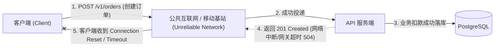
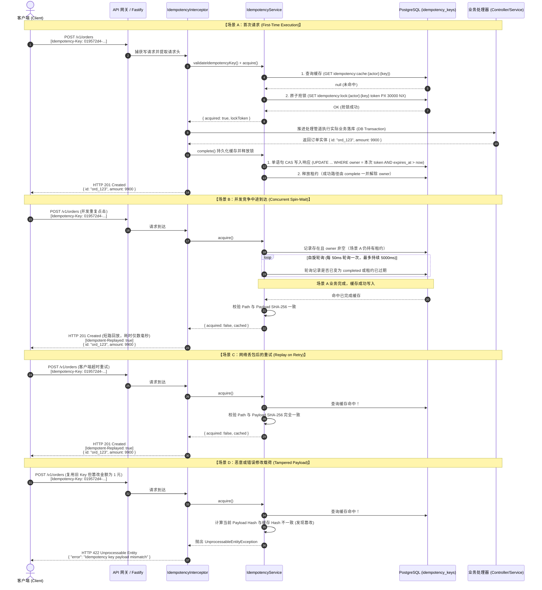

# 工业级 API 幂等性 (Idempotency) 架构与客户端接入指南

> 本规范面向全端开发工程师（Web / iOS / Android / 小程序）、后端微服务开发团队以及系统架构师，作为调用 服务端受控写操作接口的**行业工业级幂等接入标准、网络重试状态机设计、全抖动退避算法以及多语言客户端 SDK 实现指南**。

---

## 1. 工业级幂等性架构与规范总览 (Overview & Architecture)

### 1.1 分布式网络不可靠性与两军问题

在不可靠的网络环境中，分布式系统之间的 HTTP 调用永远存在**第三种状态——未知（Unknown / In-Doubt）**：



如上图所示，当客户端发起扣款或下单请求后，由于客户端超时、移动蜂窝网络切换或上游网关抖动，客户端收到了网络异常。此时客户端**无法判定**服务端究竟是：

1. **未收到请求**（操作未执行）；
2. **正在执行中**（操作排队执行中）；
3. **已成功执行完毕**，但仅仅是响应报文在回传途中丢失。

若客户端盲目发起重试，将直接引发**双重扣款、重复下单、超额发货**等灾难级资金与业务损失。

### 1.2 业界权威规范对齐

幂等子系统严格遵循现代工业界两大事实标准：

- **IETF 国际标准草案**：[`draft-ietf-httpapi-idempotency-key-header`](https://datatracker.ietf.org/doc/draft-ietf-httpapi-idempotency-key-header/)
- **Stripe / AWS 架构级生产标准**：[Stripe API Idempotent Requests](https://stripe.com/docs/api/idempotent_requests) 与 [square1-io/laravel-idempotency](https://github.com/square1-io/laravel-idempotency)

### 1.3 六大核心设计哲学

1. **自适应感知与声明式强约束 (Smart Interception & Declarative Enforcing)**：
   - 全局拦截器自动感知所有变更动词（`POST`、`PUT`、`PATCH`、`DELETE`）中携带的 `Idempotency-Key` 请求头并原子接管。
   - 关键核心交易接口支持通过 `@Idempotent({ required: true })` 强制要求客户端必须提供有效凭证，否则直接拒绝执行。
2. **单语句原子租约 (Atomic Lease in PostgreSQL)**：
   - 以 `idempotency_keys` 为载体，`INSERT ... ON CONFLICT DO UPDATE ... WHERE expires_at <= now ... RETURNING` 一条语句完成抢锁：并发下只有一个请求能写入，其余读到赢家的记录；`owner` 作为 fencing token，`complete/extend/release` 的 CAS 谓词都把 `owner` 与未过期放在同一条 `WHERE` 里。
   - 租约截止时间由**数据库时钟**推导（`EXTRACT(EPOCH FROM NOW())`），多副本无需依赖 NTP 对齐。
3. **两种并发语义（按接入方式）**：
   - 声明式 `@Idempotent()`（官方 interceptor）：首次请求仍在执行时，重复请求立即得到 `409 IDEMPOTENCY_KEY_IN_USE` + `Retry-After` 头，不占用连接自旋。
   - 编程式 `IdempotencyService`（微信支付回调等自管事务的场景）：在等待窗口内自旋轮询（默认每 50ms、最长 5s），先到请求完成后直接消费结果；超时同样返回 `409` + `Retry-After`。
4. **指纹严格校验 (Method + Path + Canonical Payload)**：
   - 指纹 = `METHOD path:sha256(canonical(payload))`：方法、路径、载荷任一不同即视为 key 复用，返回 `422` 且 `code = IDEMPOTENCY_KEY_REUSED`。Canonical JSON 对键名做字典序递归排序，兄弟属性复用同一对象不会被误判为循环引用。
5. **主体作用域精准隔离 (Actor Scope Isolation)**：
   - 幂等键在服务端自动前缀隔离：已认证用户绑定 `user:{userId}`，匿名访客绑定 `anon:{clientIp}`（未取到 IP 时统一为 `anon:unknown`）。不同租户或用户即使碰巧生成了相同的 UUID，也绝对不会发生数据碰撞或响应越权泄漏。
6. **确定性状态码分流与安全脱敏 (Deterministic Caching & Header Sanitization)**：
   - 默认缓存所有 `2xx` 成功响应以及确定性的业务失败响应（如 `400` 参数错误、`404` 找不到关联资源、`422` 业务规则冲突），防止恶意调用者通过重试绕过风控。
   - **绝对不缓存**瞬态故障：`5xx` 服务端错误；`409` 属于「仍在处理中」的拒绝（不写入记录），`422` 属于契约冲突（不运行 handler）。发生这类失败时租约被释放或自然过期，客户端可立刻退避重试。
   - 回放时自动剥离 `Set-Cookie`、`Authorization` 等敏感凭据以及 HTTP 逐跳头（Hop-by-hop headers），并注入标识头 `Idempotent-Replayed: true`（该头已通过 CORS `exposedHeaders` 暴露给浏览器）。

---

## 2. 核心执行流程与生命周期 (Lifecycle & Sequence)



---

## 3. 请求头规范与 Key 生成准则 (Header & Key Standards)

### 3.1 请求头名称与格式约束

- **请求头名称**：`Idempotency-Key`（HTTP/1.1 与 HTTP/2 协议中均不区分大小写，规范推荐使用标准驼峰命名）。
- **长度限制**：`1` 到 `256` 字符之间（超过 256 字符服务端将直接拒绝并返回 `400 Bad Request`）。
- **字符集约束**：必须为**可见 ASCII 字符**（`0x21` 到 `0x7E`，满足正则表达式 `/^[\x21-\x7E]+$/`）。
  - ❌ **严禁字符**：空格（` `）、制表符（`\t`）、换行符（`\r\n`）、中文字符、Emoji 表情。包含任何空格或非可见字符将触发 `400 Bad Request`。

### 3.2 唯一键生成算法选型推荐

| 算法标准 | 推荐度 | 优势与特性 | 适用场景 |
| :--- | :---: | :--- | :--- |
| **UUIDv7 (RFC 9562)** | 🌟 **强烈推荐 (首选)** | 内置高精度毫秒时间戳，单调时序递增，兼具极高随机性与零碰撞概率，存储与索引极度友好。 | 现代前后端、分布式微服务、批处理系统 |
| **UUIDv4 (RFC 4122)** | ✅ **完全兼容** | 122 位伪随机熵，各语言原生内置库均支持，无碰撞风险。 | 缺乏 UUIDv7 原生库的遗留客户端或简单脚本 |
| **ULID / NanoID** | ✅ **完全兼容** | 具备时间排序特性与紧凑 URL 安全字符集，长度适中。 | 移动端、桌面端 App |
| **自增整数 / 纯时间戳** | ❌ **严格禁止** | 并发环境下极易产生碰撞覆盖，导致并发请求被误当作同一次幂等回放，造成严重丢单。 | 严禁在生产环境使用 |

### 3.3 幂等键的生命周期与意图绑定原则

> ⚠️ **核心铁律：幂等键与“用户的业务意图”强绑定，严禁每次网络重试重新生成 Key！**

```text
[用户行为] 点击一次“确认支付”按钮
   │
   ├── 步骤 1: 客户端生成唯一定位该次动作的 Idempotency-Key (如 UUIDv7)
   │
   ├── 步骤 2: 发起 POST /v1/payments (携带该 Key)
   │     │
   │     ├── [网络超时 / 503 异常 / 409 并发冲突]
   │     │      │
   │     │      └── 客户端触发自动退避重试 ───┐
   │     │                                    │ (必须复用相同的 Key)
   │     └────────────────────────────────────┘
   │
   └── 步骤 3: 业务成功或用户放弃。
```

- **意图未变（重试必须复用原 Key）**：
  - 发送请求时遇到超时断网；
  - 收到 `409 Conflict`（服务端正在处理前序请求）；
  - 收到 `500` / `502` / `503` / `504` 等瞬态错误。
  - 以上所有重试动作，**必须无条件保持原有 `Idempotency-Key` 不变**！
- **意图变更（必须重新生成全新 Key）**：
  - 用户关闭了收银台，重新选择商品、更改购买数量或修改支付金额；
  - 业务校验彻底失败后，用户重新在 UI 表单中输入了新数据再次提交；
  - 此时属于一次**崭新的业务意图**，客户端**必须重新生成全新的 `Idempotency-Key`**。如果复用旧 Key，将被服务端防篡改机制直接拦截并报 `422 Unprocessable Entity`。

---

## 4. HTTP 状态码与客户端处置矩阵 (Status Code Handling Matrix)

客户端收到服务端响应时，必须严格按照下表的决策矩阵进行分支处理：

| HTTP 状态码 | 响应头 `Idempotent-Replayed` | 场景含义与服务端状态 | 客户端能否重试？ | 客户端标准处置行为 |
| :---: | :---: | :--- | :---: | :--- |
| **`200 / 201 / 204`** | `false` / 无 | **首次执行成功**。业务已持久化，响应已存入幂等缓存。 | ❌ 无需重试 | 直接向用户展示成功状态，消费响应数据体。 |
| **`200 / 201 / 204`** | **`true`** | **幂等回放成功**。未执行重复业务，直接自缓存复现历史响应。 | ❌ 无需重试 | 视为成功，与首次执行完全等效交付业务层处理；可打点记录回放发生。 |
| **`400 Bad Request`** | 无 | **请求非法**。Key 包含空格/非法字符、长度超出 256、或受控端点未传 Key。 | ❌ 禁止盲目重试 | **代码级错误**。检查客户端 Header 拼接逻辑，修复格式缺陷，不可原样重发。 |
| **`409 Conflict`** | 无 | **并发排队超时**。前序相同 Key 的请求仍在服务端执行，且超出 5s 自旋等待窗口。 | ✅ **必须重试** | **必须保持相同的 Idempotency-Key**，进入全抖动指数退避后发起重试！ |
| **`422 Unprocessable`** | 无 | **防篡改违规 (Payload/Path Mismatch)**。相同 Key 被发送到不同 URL，或请求体内容与首发不符。 | ❌ 禁止使用原 Key 重试 | **逻辑错误或 Key 污染**。排查前端状态机是否污染了旧 Key；若确需提交新载荷，必须重新生成全新 Key。 |
| **`429 Too Many`** | 无 | **请求限流**。请求触发速率限制，服务端**未占用**幂等排他锁。 | ✅ 延迟重试 | 检查响应头中的 `Retry-After`，并在该延迟结束后使用相同 Key 重试。 |
| **`500 / 502 / 504`** | 无 | **服务端偶发故障或网关超时**。服务端已自动触发安全解锁，**未沉淀**成功缓存。 | ✅ **必须重试** | **必须保持相同的 Idempotency-Key**，采用指数退避重试，服务端可安全防重入。 |
| **`503 Service Unavailable`** | 无 | **容灾阻断 (Fail-Closed)**。幂等存储（PostgreSQL）不可用，系统为防资损拒绝执行写操作。 | ✅ 延迟重试 | 保持原 Key 不变，稍后退避重试；或根据业务场景向用户提示系统繁忙。 |
| **网络断开 / Timeout** | 无 | **状态未知**。连接重置、Socket 超时，响应包在途中丢失。 | ✅ **必须重试** | **必须保持相同的 Idempotency-Key**，立即触发后台全抖动退避自动重试。 |

---

## 5. 客户端重试工程规范：全抖动指数退避 (Full Jitter Backoff)

在分布式系统集成中，简单的固定间隔重试（如每隔 1s 重试一次）会导致所有在网络抖动中失败的客户端在同一瞬间同时发起重试，瞬间击垮后端网关与数据库，形成**惊群效应与重试风暴 (Thundering Herd & Retry Storm)**。

工业界标准必须采用 **指数退避结合全抖动算法 (Exponential Backoff with Full Jitter)**。

### 5.1 算法数学模型

对于第 $i$ 次重试（$i = 0, 1, 2, \dots$）：

$$T_{\text{temp}} = \min\left(T_{\max},\; T_{\text{base}} \times 2^{i}\right)$$

$$T_{\text{sleep}} = \text{random}\left(0.5 \times T_{\text{temp}},\; 1.5 \times T_{\text{temp}}\right)$$

### 5.2 推荐参数矩阵

| 接入场景 | 基础退避 $T_{\text{base}}$ | 最大退避 $T_{\max}$ | 最大重试次数 | 适用场景特点 |
| :--- | :---: | :---: | :---: | :--- |
| **Web 前端 / H5 移动端** | `500 ms` | `3000 ms` | 3 次 | 兼顾用户界面的可感知响应等待与网络容灾 |
| **原生移动 App (iOS/Android)** | `1000 ms` | `10000 ms` | 5 次 | 应对弱网、电梯弱信号、4G/5G/Wi-Fi 基站频繁切换 |
| **B2B / 后端微服务互联** | `1000 ms` | `30000 ms` | 5 ~ 8 次 | 异步任务、支付回调通知、微服务间可靠 RPC 同步 |

---

## 6. 多语言工业级客户端实现范例 (Multi-Language SDK Patterns)

### 6.1 TypeScript / JavaScript (生产级 Axios 拦截器)

以下是具备**自动生成 UUIDv7 幂等键**、**自动识别回放响应**、**智能全抖动重试状态机**的生产级 Axios 实现：

```typescript
import axios, { type AxiosError, type AxiosInstance, type InternalAxiosRequestConfig } from 'axios';

// 扩展 Axios 配置项
declare module 'axios' {
  export interface AxiosRequestConfig {
    /** 自定义幂等键（若未提供，写操作将自动生成单调有序 UUIDv7） */
    idempotencyKey?: string;
    /** 最大自动重试次数，默认 3 */
    maxRetries?: number;
    /** 当前已重试计数 */
    retryCount?: number;
  }
}

/**
 * 生成轻量 RFC 9562 标准单调递增 UUIDv7
 */
export function generateUUIDv7(): string {
  const timestamp = Date.now();
  const hex = timestamp.toString(16).padStart(12, '0');
  
  // 构造 48 位高精度毫秒时间戳 + 12 位随机数 + 62 位真随机熵
  const randomBytes = new Uint8Array(10);
  if (typeof crypto !== 'undefined' && crypto.getRandomValues) {
    crypto.getRandomValues(randomBytes);
  } else {
    for (let i = 0; i < 10; i++) randomBytes[i] = Math.floor(Math.random() * 256);
  }

  const rHex = Array.from(randomBytes).map((b) => b.toString(16).padStart(2, '0')).join('');
  
  // version 7 (0x7000) & variant 2 (0x8000)
  return `${hex.slice(0, 8)}-${hex.slice(8, 12)}-7${rHex.slice(1, 4)}-${(
    (parseInt(rHex.slice(4, 6), 16) & 0x3f) |
    0x80
  ).toString(16)}${rHex.slice(6, 8)}-${rHex.slice(8, 20)}`;
}

/**
 * 计算全抖动退避等待时间 (Full Jitter Backoff)
 */
function calculateJitterBackoff(attempt: number, baseMs = 500, maxMs = 5000): number {
  const exponential = Math.min(maxMs, baseMs * 2 ** attempt);
  // 在 50% ~ 150% 之间随机抖动
  const jitterFactor = 0.5 + Math.random();
  return Math.floor(exponential * jitterFactor);
}

const MUTATING_METHODS = new Set(['post', 'put', 'patch', 'delete']);

export function createIdempotentClient(baseURL: string): AxiosInstance {
  const client = axios.create({
    baseURL,
    timeout: 15000,
    headers: {
      'Content-Type': 'application/json',
      Accept: 'application/json',
    },
  });

  // 1. 请求拦截器：自动注入 Idempotency-Key
  client.interceptors.request.use((config: InternalAxiosRequestConfig) => {
    const method = config.method?.toLowerCase();
    if (method && MUTATING_METHODS.has(method)) {
      // 若尚未设置幂等键，则初始化生成并持久保留在当前请求配置中
      if (!config.idempotencyKey) {
        config.idempotencyKey = generateUUIDv7();
      }
      config.headers.set('Idempotency-Key', config.idempotencyKey);
    }
    return config;
  });

  // 2. 响应拦截器：感知回放并驱动退避重试状态机
  client.interceptors.response.use(
    (response) => {
      // 检查服务端是否回放了缓存结果
      const isReplayed = response.headers['x-idempotency-replayed'] === 'true';
      if (isReplayed) {
        console.debug(`[Idempotency] Request was served from idempotency cache: ${response.config.url}`);
      }
      return response;
    },
    async (error: AxiosError) => {
      const config = error.config;
      if (!config) return Promise.reject(error);

      const maxRetries = config.maxRetries ?? 3;
      config.retryCount = config.retryCount ?? 0;

      const status = error.response?.status;
      
      // 判断是否属于可重试场景：
      // 1. 409 Conflict (并发中途排队超时)
      // 2. 5xx 服务端临时错误 (500, 502, 503, 504)
      // 3. 网络超时 / 连接中断 (无 response)
      const isNetworkError = !error.response && Boolean(error.code);
      const isTransientServerError = status ? status >= 500 && status <= 504 : false;
      const isConcurrentConflict = status === 409;

      const shouldRetry = (isNetworkError || isTransientServerError || isConcurrentConflict) && config.retryCount < maxRetries;

      // 严禁重试场景：422 防篡改失败、400 参数格式错误等业务终态错误
      if (status === 422) {
        console.error('[Idempotency Fatal] Payload or Path mismatch for key:', config.idempotencyKey);
        return Promise.reject(error);
      }

      if (shouldRetry) {
        config.retryCount += 1;
        const delayMs = calculateJitterBackoff(config.retryCount);

        console.warn(
          `[Idempotency Retry] Attempt ${config.retryCount}/${maxRetries} after ${delayMs}ms. Key: ${config.idempotencyKey}, Reason: ${error.message}`,
        );

        await new Promise((resolve) => setTimeout(resolve, delayMs));

        // 重新发起请求（因为 config 中已绑定了相同的 idempotencyKey，保证重试不会重新生成 Key）
        return client.request(config);
      }

      return Promise.reject(error);
    },
  );

  return client;
}
```

### 6.2 TypeScript / 原生 Modern Fetch 包装器 (无第三方依赖)

适用于现代浏览器、Next.js / Nuxt 3、Cloudflare Workers 等轻量环境：

```typescript
export interface IdempotentFetchOptions extends RequestInit {
  idempotencyKey?: string;
  maxRetries?: number;
  baseTimeoutMs?: number;
}

export async function idempotentFetch(url: string, options: IdempotentFetchOptions = {}): Promise<Response> {
  const { maxRetries = 3, baseTimeoutMs = 10000, ...fetchInit } = options;
  const method = (fetchInit.method || 'GET').toUpperCase();

  const headers = new Headers(fetchInit.headers);

  // 为所有非安全写操作注入固定 Idempotency-Key
  if (['POST', 'PUT', 'PATCH', 'DELETE'].includes(method)) {
    if (!headers.has('Idempotency-Key')) {
      const key = options.idempotencyKey || (typeof crypto !== 'undefined' ? crypto.randomUUID() : `${Date.now()}`);
      headers.set('Idempotency-Key', key);
    }
  }

  let attempt = 0;

  while (true) {
    const controller = new AbortController();
    const timeoutId = setTimeout(() => controller.abort(), baseTimeoutMs);

    try {
      const response = await fetch(url, {
        ...fetchInit,
        headers,
        signal: controller.signal,
      });

      clearTimeout(timeoutId);

      // 409 Conflict 或 5xx 服务端错误允许退避重试
      if ((response.status === 409 || response.status >= 500) && attempt < maxRetries) {
        throw new Error(`Server returned retryable status: ${response.status}`);
      }

      return response;
    } catch (err: unknown) {
      clearTimeout(timeoutId);
      attempt++;

      if (attempt > maxRetries) {
        throw err;
      }

      // 指数退避加全抖动
      const backoffMs = Math.floor(Math.min(5000, 500 * 2 ** attempt) * (0.5 + Math.random()));
      await new Promise((r) => setTimeout(r, backoffMs));
    }
  }
}
```

### 6.3 Dart / Flutter (生产级 Dio 拦截器与退避重试)

适用于 Flutter 移动应用、桌面端与 Dart 全端客户端，使用业界标准的 `dio` 库实现：

```dart
import 'dart:async';
import 'dart:math';
import 'package:dio/dio.dart';

/// 工业级 Dio 幂等与全抖动指数退避重试拦截器
class IdempotencyInterceptor extends Interceptor {
  final Dio dio;
  final int defaultMaxRetries;
  final int defaultBaseDelayMs;
  final int defaultMaxDelayMs;
  final _random = Random();

  static const _mutatingMethods = {'POST', 'PUT', 'PATCH', 'DELETE'};
  static const _idempotencyHeader = 'Idempotency-Key';
  static const _retryCountKey = 'idempotency_retry_count';
  static const _originalKeyKey = 'idempotency_original_key';

  IdempotencyInterceptor({
    required this.dio,
    this.defaultMaxRetries = 3,
    this.defaultBaseDelayMs = 500,
    this.defaultMaxDelayMs = 5000,
  });

  /// 生成单调时序 UUIDv7 (RFC 9562 标准)
  String generateUUIDv7() {
    final now = DateTime.now().millisecondsSinceEpoch;
    final timeHex = now.toRadixString(16).padLeft(12, '0');
    final rand = List<int>.generate(10, (_) => _random.nextInt(256));
    final randHex = rand.map((b) => b.toRadixString(16).padLeft(2, '0')).join();

    final timeHigh = timeHex.substring(0, 8);
    final timeMid = timeHex.substring(8, 12);
    final ver = '7${randHex.substring(0, 3)}';
    final varByte = (int.parse(randHex.substring(3, 5), radix: 16) & 0x3f) | 0x80;
    final varHex = varByte.toRadixString(16).padLeft(2, '0');
    final rest = randHex.substring(5, 17);

    return '$timeHigh-$timeMid-$ver-$varHex${randHex.substring(5, 7)}-$rest';
  }

  /// 计算全抖动指数退避 (Full Jitter Backoff)
  int _calculateJitterBackoff(int attempt, int baseMs, int maxMs) {
    final exponential = min(maxMs, baseMs * (1 << attempt));
    final jitterFactor = 0.5 + _random.nextDouble(); // 50% ~ 150% 浮动区间打散热点
    return (exponential * jitterFactor).toInt();
  }

  @override
  void onRequest(RequestOptions options, RequestInterceptorHandler handler) {
    final method = options.method.toUpperCase();
    if (_mutatingMethods.contains(method)) {
      // 若尚未设置幂等键，则初始化生成并持久保留在 options.extra 中
      String? key = options.headers[_idempotencyHeader] as String?;
      if (key == null || key.isEmpty) {
        key = (options.extra[_originalKeyKey] as String?) ?? generateUUIDv7();
        options.headers[_idempotencyHeader] = key;
        options.extra[_originalKeyKey] = key;
      }
    }
    handler.next(options);
  }

  @override
  void onResponse(Response response, ResponseInterceptorHandler handler) {
    // 检测服务端是否回放了幂等缓存响应
    final isReplayed = response.headers.value('x-idempotency-replayed') == 'true';
    if (isReplayed) {
      // 可用于客户端日志埋点或性能打点：短路缓存命中
    }
    handler.next(response);
  }

  @override
  Future<void> onError(DioException err, ErrorInterceptorHandler handler) async {
    final options = err.requestOptions;
    final method = options.method.toUpperCase();

    // 非写请求不执行幂等重试状态机
    if (!_mutatingMethods.contains(method)) {
      return handler.next(err);
    }

    final statusCode = err.response?.statusCode;
    // 确定性业务终态错误（422 防篡改失败、400 格式错误、401/403 权限问题）严禁重试
    if (statusCode == 422 || statusCode == 400 || statusCode == 401 || statusCode == 403) {
      return handler.next(err);
    }

    // 判定可重试场景：
    // 1. 网络连接超时、发送超时、接收超时或连接断开
    // 2. 409 Conflict (服务端并发自旋排队超时)
    // 3. 500 ~ 504 服务端临时偶发异常
    final isTimeoutOrNetwork = err.type == DioExceptionType.connectionTimeout ||
        err.type == DioExceptionType.sendTimeout ||
        err.type == DioExceptionType.receiveTimeout ||
        err.type == DioExceptionType.connectionError;
    final isConcurrentConflict = statusCode == 409;
    final isTransientServer = statusCode != null && statusCode >= 500 && statusCode <= 504;

    final shouldRetry = isTimeoutOrNetwork || isConcurrentConflict || isTransientServer;
    final currentRetry = (options.extra[_retryCountKey] as int?) ?? 0;
    final maxRetries = defaultMaxRetries;

    if (shouldRetry && currentRetry < maxRetries) {
      final nextAttempt = currentRetry + 1;
      options.extra[_retryCountKey] = nextAttempt;

      final backoffMs = _calculateJitterBackoff(
        nextAttempt,
        defaultBaseDelayMs,
        defaultMaxDelayMs,
      );

      await Future.delayed(Duration(milliseconds: backoffMs));

      try {
        // 复用原有 RequestOptions（保证 Idempotency-Key 严格一致），重新发起请求
        final response = await dio.fetch(options);
        return handler.resolve(response);
      } on DioException catch (retryErr) {
        return handler.next(retryErr);
      }
    }

    handler.next(err);
  }
}
```

### 6.4 Android / Kotlin (生产级 OkHttp / Retrofit 拦截器)

适用于 Android 原生应用（Kotlin / Retrofit / OkHttp），通过应用拦截器自动接管幂等状态机：

```kotlin
package com.nestforge.client.idempotency

import okhttp3.Interceptor
import okhttp3.Request
import okhttp3.Response
import java.io.IOException
import java.util.UUID
import kotlin.math.min
import kotlin.math.pow
import kotlin.random.Random

/**
 * 工业级 OkHttp / Retrofit 幂等与全抖动指数退避拦截器
 *
 * 核心保障：
 * 1. 自动为非安全写操作 (POST/PUT/PATCH/DELETE) 注入单调 UUID 幂等键
 * 2. 严格保证重试期间复用同一 Idempotency-Key，杜绝重试导致二次落库
 * 3. 实现 Full Jitter 全抖动指数退避算法，打散瞬时集中流量
 * 4. 智能区分 409/5xx/网络异常（可重试）与 400/422（终态不可重试）
 */
class IdempotencyInterceptor(
    private val maxRetries: Int = 3,
    private val baseDelayMs: Long = 500L,
    private val maxDelayMs: Long = 5000L
) : Interceptor {

    companion object {
        const val HEADER_IDEMPOTENCY_KEY = "Idempotency-Key"
        const val HEADER_REPLAYED = "Idempotent-Replayed"
        private val MUTATING_METHODS = setOf("POST", "PUT", "PATCH", "DELETE")
    }

    @Throws(IOException::class)
    override fun intercept(chain: Interceptor.Chain): Response {
        val originalRequest = chain.request()
        val method = originalRequest.method.uppercase()

        // 仅对非幂等修改请求生效
        if (method !in MUTATING_METHODS) {
            return chain.proceed(originalRequest)
        }

        // 提取已有 Key 或初始化生成唯一定位当前意图的 Key
        val idempotencyKey = originalRequest.header(HEADER_IDEMPOTENCY_KEY)
            ?: UUID.randomUUID().toString()

        // 注入请求头（后续重试必须完全复用此 request，确保 Key 绝对保持一致）
        val requestWithKey = originalRequest.newBuilder()
            .header(HEADER_IDEMPOTENCY_KEY, idempotencyKey)
            .build()

        var attempt = 0
        var lastException: IOException? = null
        var lastResponse: Response? = null

        while (attempt <= maxRetries) {
            if (attempt > 0) {
                // 计算全抖动指数退避等待时长
                val delayMs = calculateJitterBackoff(attempt, baseDelayMs, maxDelayMs)
                try {
                    Thread.sleep(delayMs)
                } catch (e: InterruptedException) {
                    Thread.currentThread().interrupt()
                    throw IOException("Idempotency retry interrupted", e)
                }
            }

            try {
                lastResponse?.close() // 释放上一轮未成功消费的响应体
                val response = chain.proceed(requestWithKey)

                // 检查服务端是否命中了短路回放
                if (response.header(HEADER_REPLAYED).equals("true", ignoreCase = true)) {
                    // 可上报 APM 监控：命中缓存回放
                }

                val code = response.code

                // 遇到不可重试的状态码（成功 2xx、参数错误 400、防篡改失败 422 等），直接返回
                val isRetryableStatus = code == 409 || (code in 500..504)
                if (!isRetryableStatus || attempt >= maxRetries) {
                    return response
                }

                // 属于 409 并发自旋超时或 5xx 服务端故障，进入下一轮退避重试
                lastResponse = response
                attempt++
            } catch (e: IOException) {
                // 捕获网络断开、超时、Socket 重置等传输层异常
                lastException = e
                attempt++
                if (attempt > maxRetries) {
                    throw e
                }
            }
        }

        lastResponse?.let { return it }
        throw lastException ?: IOException("Request failed after $maxRetries idempotency retries")
    }

    /**
     * 计算 Full Jitter 全抖动指数退避：
     * temp = min(maxDelay, baseDelay * 2^attempt)
     * sleep = random(0.5 * temp, 1.5 * temp)
     */
    private fun calculateJitterBackoff(attempt: Int, baseMs: Long, maxMs: Long): Long {
        val exponential = min(maxMs.toDouble(), baseMs * (2.0.pow(attempt.toDouble())))
        val jitterFactor = 0.5 + Random.nextDouble() // 50% ~ 150% 浮动区间打散热点
        return (exponential * jitterFactor).toLong()
    }
}
```

### 6.5 cURL 终端调试与自动化测试实战

#### 场景 1：首次正常发送写操作并记录

```bash
# 1. 生成符合规范的测试 UUID
KEY=$(uuidgen)

# 2. 首次发起请求
curl -i -X POST "http://localhost:4300/v1/orders" \
  -H "Authorization: Bearer <TOKEN>" \
  -H "Idempotency-Key: $KEY" \
  -H "Content-Type: application/json" \
  -d '{"skuId":"SKU_1001","quantity":2}'
```

*预期输出*：返回 `HTTP/1.1 201 Created`，无 `Idempotent-Replayed` 头。

#### 场景 2：相同 Key 立即重复请求（验证回放缓存）

```bash
# 保持相同 KEY 重复发送
curl -i -X POST "http://localhost:4300/v1/orders" \
  -H "Authorization: Bearer <TOKEN>" \
  -H "Idempotency-Key: $KEY" \
  -H "Content-Type: application/json" \
  -d '{"skuId":"SKU_1001","quantity":2}'
```

*预期输出*：

```http
HTTP/1.1 201 Created
x-idempotency-replayed: true
Content-Type: application/json; charset=utf-8
Content-Length: 148

{"code":0,"data":{"id":"ord_019572...","skuId":"SKU_1001","quantity":2},"message":"success"}
```

耗时显著降低至 2~5ms，且响应头携带显式的 `x-idempotency-replayed: true`。

#### 场景 3：相同 Key 携带篡改的 Payload 发送（验证 422 防篡改）

```bash
# 保持相同 KEY，但将数量由 2 篡改为 99
curl -i -X POST "http://localhost:4300/v1/orders" \
  -H "Authorization: Bearer <TOKEN>" \
  -H "Idempotency-Key: $KEY" \
  -H "Content-Type: application/json" \
  -d '{"skuId":"SKU_1001","quantity":99}'
```

*预期输出*：

```http
HTTP/1.1 422 Unprocessable Entity
Content-Type: application/json; charset=utf-8

{"statusCode":422,"message":"Idempotency key payload mismatch","error":"Unprocessable Entity"}
```

#### 场景 4：Key 包含非法字符验证（验证 400 校验）

```bash
# 传入包含空格的非法 Key
curl -i -X POST "http://localhost:4300/v1/orders" \
  -H "Idempotency-Key: invalid key with spaces" \
  -H "Content-Type: application/json" \
  -d '{"skuId":"SKU_1001"}'
```

*预期输出*：

```http
HTTP/1.1 400 Bad Request
Content-Type: application/json; charset=utf-8

{"statusCode":400,"message":"Idempotency-Key header contains invalid characters. Only printable ASCII characters are allowed.","error":"Bad Request"}
```

---

## 7. 服务端装饰器与行为控制速查 (Server-Side Reference)

为了让全栈开发人员更好地协同理解，提供了极其简洁的声明式注解 `@Idempotent(options)`：

```typescript
import { Controller, Post, Body } from '@nestjs/common';
import { Idempotent } from '@/common/idempotency';

@Controller('payments')
export class PaymentsController {
  
  @Post('charge')
  @Idempotent({
    required: true,           // 强制要求客户端必须提供 Idempotency-Key 请求头（缺省返回 400）
    ttlSeconds: 86400,        // 幂等记录留存时间（默认 24 小时）
    waitTimeoutMs: 5000,      // 并发请求在服务端自旋等待前序完成的最长窗口（默认 5000ms，超时报 409）
    lockTtlMs: 30000,         // 分布式业务锁最长租约，防止业务宕机死锁（默认 30s）
    fallback: 'fail-closed',  // 存储不可用时的容灾策略：'fail-closed' 抛 503 防资损（默认），或 'fail-open' 放行
  })
  async createCharge(@Body() dto: CreateChargeDto) {
    return this.paymentsService.charge(dto);
  }
}
```

> 💡 **自适应规则**：对于未标注 `@Idempotent()` 的普通写接口（`POST`/`PUT`/`PATCH`/`DELETE`），只要客户端主动传递了 `Idempotency-Key` 请求头，系统依然会自动以默认参数接管并提供全套防重保护。

---

## 8. 生产环境十大反模式与排查清单 (Anti-Patterns & Checklist)

### 8.1 严禁触碰的反模式 (Anti-Patterns)

1. ❌ **反模式 1：每次重试重新生成 Key**
   - **错误现象**：在 Catch 到网络超时或 504 网关超时后，客户端重试代码重新调用了一次 `uuid()`。
   - **灾难后果**：彻底摧毁幂等防护，引发资损双花。
   - **正解**：一次交互动作只生成一个 Key，该动作发起的所有重试必须沿用同一个 Key。
2. ❌ **反模式 2：在安全幂等读操作（GET/HEAD）上附加幂等键**
   - **错误现象**：在获取列表或查询详情请求中也拼接了 `Idempotency-Key`。
   - **不良后果**：导致查询操作无谓占用幂等租约与记录存储开销，且违背 HTTP 规范。
   - **正解**：仅对非幂等修改动词（`POST`、`PUT`、`PATCH`、`DELETE`）启用幂等机制。
3. ❌ **反模式 3：在循环批处理中共享全局单例 Key**
   - **错误现象**：在异步 Job 或循环上传多个不同文件时，复用了同一个字符串作为 Key。
   - **不良后果**：后续请求立即触发 `422 Payload Mismatch`，导致后续批处理全部中断失败。
   - **正解**：循环中的每一个独立实体或子项必须拥有自己独立的 Key。
4. ❌ **反模式 4：捕获 409 Conflict 后直接弹窗提示失败**
   - **错误现象**：客户端遇到 409 状态码直接向终端用户弹窗报错：“创建订单冲突”。
   - **不良后果**：恶化用户体验。409 仅表示前序请求仍在处理中。
   - **正解**：SDK 应在后台自动执行 1~2 秒的静默退避重试，直接消费前序计算好的结果，对最终用户完全无感。
5. ❌ **反模式 5：客户端超时时间设置短于服务端自旋超时**
   - **错误现象**：客户端 HTTP 客户端 timeout 配置了 2 秒，但服务端自旋等待时间为 5 秒。
   - **不良后果**：后到的并发请求在服务端还在优雅等待前序结果时，客户端就已经因超时主动掐断连接，造成误报。
   - **正解**：客户端请求超时时间应设置为服务端自旋等待窗口的 2~3 倍（如客户端统一设置为 10s ~ 15s）。
6. ❌ **反模式 6：在 Key 中注入用户敏感信息或私密数据**
   - **错误现象**：使用 `md5(idCard + bankCard)` 作为幂等 Key。
   - **不良后果**：Key 会记录在网关访问日志（Access Log）和 Redis 监控探针中，造成隐私泄露。
   - **正解**：仅使用随机高熵字符串（如 UUIDv7 / ULID）。
7. ❌ **反模式 7：重试没有配置退避与抖动**
   - **错误现象**：使用 `for (let i=0; i<3; i++) await fetch(...)` 连续狂发请求。
   - **不良后果**：引发重试风暴，压垮本已处于高负载状态的网关与应用容器。
   - **正解**：强制采用带随机抖动的指数退避（Full Jitter）。
8. ❌ **反模式 8：误将 422 业务校验错误当成网络错误重试**
   - **错误现象**：客户端将所有非 200 响应统一放进重试队列。
   - **不良后果**：导致持续产生无意义的重试请求，浪费流量。
   - **正解**：422、400、401、403 为不可重试的确定性业务状态，必须立即终止重试。

### 8.2 客户端交付前自检清单 (Pre-Flight Checklist)

- [ ] **Key 规范**：使用的 Key 长度是否控制在 256 字符内？是否仅包含可见 ASCII 字符且无空格？
- [ ] **算法推荐**：是否优先采用具备时序递增特性的 **UUIDv7** 算法？
- [ ] **重试稳定性**：同一动作下的所有自动重试是否严格保持相同的 `Idempotency-Key`？
- [ ] **状态机分支**：
  - [ ] 遇到网络中断、`409`、`5xx` 时是否自动执行退避重试？
  - [ ] 遇到 `422`、`400`、`401`、`403` 时是否立即终止重试并向上抛出业务异常？
- [ ] **全抖动算法**：重试等待时长是否包含随机浮动因子（避免集中并发碰撞）？
- [ ] **超时适配**：客户端网络读取超时（Timeout）是否不少于 10 秒？
- [ ] **脱敏与回放**：业务逻辑是否正确识别了 `Idempotent-Replayed: true` 标记？

---

## 9. 参考文献与标准 (References)

1. [IETF The Idempotency-Key HTTP Header Field (Draft-04)](https://datatracker.ietf.org/doc/draft-ietf-httpapi-idempotency-key-header/)
2. [RFC 9562: Universally Unique IDentifiers (UUIDv7 Specification)](https://www.rfc-editor.org/rfc/rfc9562.html)
3. [Stripe Engineering: Designing robust and predictable APIs with idempotency](https://stripe.com/blog/idempotency)
4. [AWS Architecture Blog: Exponential Backoff And Jitter](https://aws.amazon.com/blogs/architecture/exponential-backoff-and-jitter/)
5. [square1-io/laravel-idempotency](https://github.com/square1-io/laravel-idempotency)
