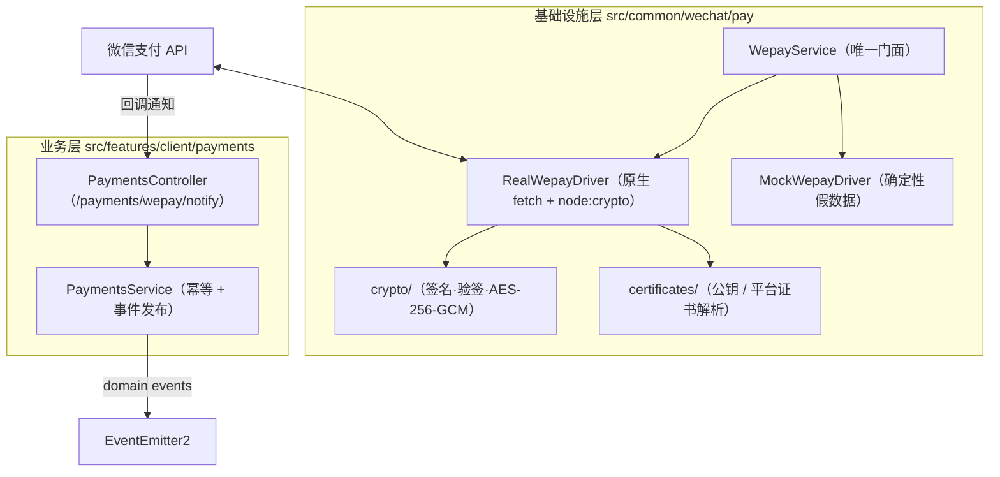

# 微信支付 v3 接入与回调治理指南

> 本文档面向后端与全端开发团队，说明微信支付 v3（直连商户）的能力边界、驱动模式、凭证配置、下单/退款/账单调用方式，以及回调链路的验签、解密与幂等治理规范。

---

## 1. 架构总览

支付能力分为**基础设施层**与**业务层**两级，边界严格对齐项目既有的 `src/common/` 与 `src/features/` 约定：



- **基础设施层零业务语义**：只负责签名、验签、加解密、HTTP 调用与凭据管理，失败一律抛 `WepayException`，交由全局 `HttpExceptionFilter` 输出统一错误信封。
- **业务层零加密细节**：只负责幂等判重与领域事件发布，不关心报文如何验签解密。
- **零新增依赖**：签名（SHA256withRSA）、验签、AES-256-GCM 解密与 HTTP 客户端分别基于 `node:crypto` 与原生 `fetch` 实现。
- **微信域目录**：本模块位于 `src/common/wechat/pay/`，与 `src/common/wechat/miniprogram/`（小程序服务端 API，见 [`docs/wechat-miniprogram.md`](./wechat-miniprogram.md)）并排；`src/common/wechat/` 收敛全部微信生态服务端能力。

---

## 2. 环境变量与驱动模式

### 2.1 驱动推导

`WEPAY_DRIVER` 留空时按凭证齐全度自动推导（对齐 `SEARCH_DRIVER` 的推导范式）：

| 条件 | 推导结果 |
| :--- | :--- |
| `WEPAY_APPID` + `WEPAY_MCHID` + `WEPAY_SERIAL_NO` + `WEPAY_APIV3_KEY` + （`WEPAY_PRIVATE_KEY` 或 `WEPAY_PRIVATE_KEY_PATH`）齐备 | `real` |
| 其余情况 | `mock` |

> **生产保护**：`APP_ENV=production` 且推导结果为 `mock` 时，应用**直接阻断启动**并提示缺失项，避免静默降级造成资金风险。

### 2.2 变量清单

| 变量 | 说明 |
| :--- | :--- |
| `WEPAY_DRIVER` | `real` 或 `mock`，留空自动推导 |
| `WEPAY_APPID` | 直连商户申请的公众号或移动应用 appid |
| `WEPAY_MCHID` | 直连商户号 |
| `WEPAY_SERIAL_NO` | 商户 API 证书序列号 |
| `WEPAY_PRIVATE_KEY` | 商户 API 私钥（内联 PEM，支持 `\n` 转义），优先级高于路径 |
| `WEPAY_PRIVATE_KEY_PATH` | 商户 API 私钥文件路径（相对项目根目录），须加入 `.gitignore` |
| `WEPAY_APIV3_KEY` | 32 字节 APIv3 密钥，用于回调解密与平台证书解密 |
| `WEPAY_PUBLIC_KEY` / `WEPAY_PUBLIC_KEY_ID` | 微信支付公钥与公钥 ID，**成对配置即走公钥模式** |
| `WEPAY_NOTIFY_URL` | 默认回调地址，单次下单可通过 `notifyUrl` 覆盖 |
| `WEPAY_API_BASE` | API 基址，默认 `https://api.mch.weixin.qq.com` |
| `WEPAY_TIMEOUT_MS` | 请求超时，默认 `15000` |

### 2.3 验签凭据双模式

| 模式 | 触发条件 | 行为 |
| :--- | :--- | :--- |
| **微信支付公钥** | 同时配置 `WEPAY_PUBLIC_KEY` 与 `WEPAY_PUBLIC_KEY_ID` | 零下载、零轮转，按应答头 `Wechatpay-Serial` 精确匹配公钥 ID；2024 年后新商户推荐 |
| **平台证书** | 未配置公钥 | 首次调用或回调时按需拉取 `/v3/certificates`，解密后按 `serial_no` 建索引缓存，12 小时 TTL **惰性刷新**（并发共享同一刷新 Promise 防击穿） |

> 平台证书模式下拉取失败时，若已有可用缓存则记录 `warn` 继续运行；首次拉取失败则上抛，避免「静默不可验签」。

---

## 3. 调用方式

`WepayService` 为全局 `@Global()` 模块导出的唯一门面，业务侧直接注入即可。

### 3.1 下单（四场景独立方法）

每种场景必填字段差异很大（JSAPI 必填 `payer.openid`、H5 必填 `sceneInfo.h5_info`），因此提供四个独立方法以在编译期约束参数：

```ts
// Native 扫码：返回 codeUrl，由调用方决定二维码渲染方式
const { codeUrl } = await wepay.createNative({
  outTradeNo: 'WP20260101120000000001',
  description: '年度会员',
  amount: { total: 9900 },
});

// JSAPI：返回 prepayId 与可直接下发给前端的二次签名参数
const { payParams } = await wepay.createJsapi({
  outTradeNo: 'WP20260101120000000002',
  description: '年度会员',
  amount: { total: 9900 },
  payer: { openid: 'oUpF8uMuAJO_M2pxb1Q9zNjWeS6o' },
});

// H5：返回跳转链接
const { h5Url } = await wepay.createH5({ /* ... */, sceneInfo: { payer_client_ip: '1.2.3.4', h5_info: {...} } });

// App：返回移动端 SDK 所需参数
const { payParams: appParams } = await wepay.createApp({ /* ... */ });
```

`outTradeNo` **必须由调用方提供**（它既是微信侧幂等键，也是业务主键）。如需生成器，可使用纯函数工具：

```ts
const outTradeNo = wepay.buildOutTradeNo('WP'); // WP + yyyyMMddHHmmss + 6 位随机数（22 字符）
```

### 3.2 查询、关单、退款与账单

```ts
await wepay.queryByOutTradeNo(outTradeNo);
await wepay.queryByTransactionId(transactionId);
await wepay.close(outTradeNo);
await wepay.refund({ outRefundNo, outTradeNo, amount: { refund: 100, total: 9900 } });
await wepay.queryRefund(outRefundNo);
const tradeBill = await wepay.downloadTradeBill({ billDate: '2026-01-01', billType: 'ALL' });
const fundFlow = await wepay.downloadFundFlowBill({ billDate: '2026-01-01', accountType: 'BASIC' });
```

#### 退款状态语义

退款是异步过程：**申请成功 ≠ 到账成功**。申请接口返回的 `status` 与回调送达的状态都取自下表：

| 状态 | 含义 | 业务动作 |
| :--- | :--- | :--- |
| `PROCESSING` | 退款处理中 | 等待回调，或轮询 `queryRefund()` |
| `SUCCESS` | 退款成功 | 释放业务侧冻结/记账 |
| `ABNORMAL` | 退款异常（如收款银行卡已注销） | **人工介入**，或更换退款方式后重新发起 |
| `CLOSED` | 退款关闭（资金已退回商户） | **重新发起**退款 |

`ABNORMAL` 与 `CLOSED` 均不会再有后续回调，必须显式处理，因此分别映射为 `payment.refund_failed` 事件的 `status`。

#### 退款回调地址规则

与下单一致：`notifyUrl` 单次覆盖优先，其次回退 `WEPAY_NOTIFY_URL`。**两者皆缺时微信不推送退款结果**（退款允许纯查询模式），此时业务侧需自行轮询 `queryRefund()` 兜底。

#### 退款入参前置校验

以下情况会在**发起网络请求前**被本地拦截（状态码与微信 `PARAM_ERROR` 对齐，同归 400），避免无效往返：

| 校验 | 错误码 |
| :--- | :--- |
| `outRefundNo` 缺失 | `WEPAY_REFUND_NO_MISSING` |
| `transactionId` 与 `outTradeNo` 同时缺失 | `WEPAY_REFUND_TARGET_MISSING` |
| `amount.total` / `amount.refund` 非正整数（分） | `WEPAY_REFUND_AMOUNT_INVALID` |
| `amount.refund > amount.total` | `WEPAY_REFUND_AMOUNT_EXCEEDED` |

> 全额退款（`refund >= total`）才会把交易状态置为 `REFUND`，部分退款保持原状 —— mock 驱动与微信语义保持一致。

#### 账单下载规则

账单是**异步生成**的：微信在账单日**次日北京时间 10:00** 起生成，且仅支持下载近三个月内的账单。

| 规则 | 处理方式 |
| :--- | :--- |
| 日期格式非 `yyyy-MM-DD` 或日期不存在（如 2 月 30 日） | 本地拦截 → `WEPAY_BILL_DATE_INVALID`(400)，不发起请求 |
| 账单日尚未到次日 10:00（北京时间） | 本地拦截 → `WEPAY_BILL_NOT_READY`(400)，不发起请求 |
| 账单日超出近三个月回溯范围 | 本地拦截 → `WEPAY_BILL_DATE_OUT_OF_RANGE`(400)，不发起请求 |
| 已到生成时刻但微信返回 `STATEMENT_CREATING` / 下载地址缺失 | **长间隔退避重试 3 次 × 10 秒**（覆盖「刚过生成时刻尚未落盘」的窗口） |
| 微信返回 `NO_STATEMENT_EXIST` | 确定性结果（当日无资金变动），**不重试**，直接上报 400 |

> 跨天等待（例如「每天定时拉取昨日账单」）**不在请求链路中阻塞**，应由业务侧定时任务在 T+1 10:00 之后触发。本地日期门禁已消除绝大多数注定失败的调用。

#### 账单下载与完整性校验

申请账单应答固定返回 `hash_type`（官方固定 `SHA1`）、`hash_value` 与 `download_url`（**5 分钟内有效**）。下载链路严格按官方要求实现：

| 步骤 | 实现 |
| :--- | :--- |
| 签名 | 对 `download_url` 的 **path + query** 按 APIv3 标准签名并携带 `Authorization` 请求（并非「URL 自带 token 即可免签名」） |
| 解压 | `tar_type=GZIP` 时以 gzip 解压；失败上报 `WEPAY_BILL_DECOMPRESS_FAILED`(502) |
| 校验 | 以 `hash_value` 校验**解压后**原始账单的 SHA1（官方口径：「原始账单(gzip需要解压缩)的摘要值」）；不一致上报 `WEPAY_BILL_HASH_MISMATCH`(502)，绝不把来路不明的内容交给业务侧 |
| 错误 | 下载地址过期或请求方与申请方不一致时，透传微信的 `400 INVALID_REQUEST` / `403 NO_AUTH` |
| 重试 | 整个下载步骤纳入读操作重试（瞬态故障可重试） |

> 直连商户账单**未加密**（`encrypt_key` / `nonce` 仅出现在二级商户资金账单场景），因此无需额外解密；`tar_type` 不传时以数据流形式返回，原样透传。

### 3.3 容错策略

| 操作类型 | 重试 | 说明 |
| :--- | :--- | :--- |
| 查询 / 退款查询 / 账单下载 | ✅ 最多 2 次，仅 5xx、429 与网络异常 | 幂等安全 |
| 下单 / 关单 / 退款 | ❌ 不重试 | 避免放大不确定性 |
| 熔断 | ❌ 不接入 | 支付场景熔断后业务完全无法下单/查单，可能比原故障更糟；仅保留超时保护 |

---

## 4. 回调链路

### 4.1 原始报文验签（关键约束）

微信 `Wechatpay-Signature` 覆盖的待签名串包含**原始 body 字符串**，重新 `JSON.stringify` 必然验签失败。项目在 `src/main.ts` 的 `NestFactory.create` 选项中启用了 NestJS 原生 `rawBody: true` 支持：

```ts
const app = await NestFactory.create<NestFastifyApplication>(AppModule, createFastifyAdapter(), {
  bufferLogs: true,
  rawBody: true,
});
```

NestJS 的 `FastifyAdapter` 会在内部自动将原始报文 Buffer 挂载至 `request.rawBody`，同时保留 Fastify 原生安全的 JSON 解析（防原型污染与 bodyLimit），并在 `PaymentsController.extractRawBody` 中自动将 Buffer 解码为 UTF-8 字符串用于验签，保证 controller 既有 `request.body` 语义零破坏。

### 4.2 处理流程

```text
POST /v1/payments/wepay/notify
  @Public() @BypassTransform() → 无需鉴权，但必须通过验签与解密双重校验
      1. verifyAndDecryptNotify()：验签（5 分钟时间戳容差防重放）+ AES-256-GCM 解密
      2. IdempotencyService 以回调通知 ID 为键去重（24h TTL，fail-closed）
      3. 发布领域事件 → payment.notify.received / payment.succeeded / payment.refunded / payment.refund_failed
  → 成功 204 空体；验签失败 401；处理失败 500（微信按退避策略重投）
```

> 微信**不解析**回调响应体，仅判断状态码，故 204 空响应体是最干净的契约，天然无需绕过响应信封。

### 4.3 幂等与订阅

- 微信会**重复投递**同一回调直到收到 2xx，幂等由 `PaymentsService` 通过项目既有的 `IdempotencyService`（Redis 排他锁 + 响应回放 + 422 篡改校验）承担，基建层不做业务去重。
- 支付模块**只发内部领域事件**，不直连 Centrifugo。是否广播/落库由订阅方决定，符合 `realtime/` 作为统一实时中枢的分层约定。

```ts
@OnEvent(PAYMENT_EVENTS.SUCCEEDED)
async onPaymentSucceeded(event: PaymentSucceededEvent): Promise<void> {
  // 更新订单状态、发放权益……
}
```

---

## 5. 错误映射

微信错误码统一按官方「公共错误码 / 业务错误码」映射为语义化 HTTP 状态，并归入可判定可重试性的分类。

### 5.1 错误分类与可重试性

| 分类 | 含义 | 可重试 | 业务处置 |
| :--- | :--- | :---: | :--- |
| `invalid-request` | 参数或配置不符 | ❌ | 修参数/配置，重试无意义 |
| `auth` | 签名、证书或商户权限问题 | ❌ | 修配置或申请权限 |
| `business-state` | 订单/账单状态冲突 | ❌ | 业务分支处理 |
| `account` | 商户或用户账户侧问题 | ❌ | 人工介入 |
| `not-found` | 目标资源不存在 | ❌ | 核对单号 |
| `rate-limited` | 频率限制 | ✅ | 退避后重试 |
| `upstream` | 微信侧系统异常 | ✅ | 原样重试 |

调用方无需硬编码错误码字符串：

```ts
try {
  await wepay.refund(input);
} catch (error) {
  if (isWepayRetryable(error)) {
    // 交给队列退避重试
  } else if (isWepayError(error) && error.category === 'business-state') {
    // 订单状态冲突，走业务分支
  }
  throw error;
}
```

字段级定位信息与追查标识均已结构化保留：`error.detail`（`field` / `value` / `issue` / `location`）与 `error.requestId`（微信侧 request-id）。

### 5.2 错误码映射

| 归属 | 微信 code | HTTP |
| :--- | :--- | :--- |
| 公共 | `PARAM_ERROR` `INVALID_REQUEST` | 400 |
| 公共 | `SIGN_ERROR` | 401 |
| 公共 | `SYSTEM_ERROR` | 500 |
| 商户 | `APPID_MCHID_NOT_MATCH` | 400 |
| 商户 | `MCH_NOT_EXISTS` `APPID_NOT_EXIST` | 404 |
| 商户 | `NO_AUTH` / `NOAUTH` | 403 |
| 交易 | `ORDER_CLOSED` `ORDER_PAID` | 400 |
| 交易 | `OUT_TRADE_NO_USED` `RULE_LIMIT` `TRADE_ERROR` | 403 |
| 账户 | `ACCOUNT_ERROR` `NOT_ENOUGH` `USER_ACCOUNT_ABNORMAL` | 403 |
| 资源 | `RESOURCE_NOT_EXISTS` `ORDER_NOT_EXIST` `USER_NOT_EXISTS` | 404 |
| 账单 | `NO_STATEMENT_EXIST` `STATEMENT_CREATING` | 400 |
| 频率 | `FREQUENCY_LIMITED` | 429 |
| 未收录 | — | 透传微信自身 4xx；5xx 与缺失兜底 502 |

> **100% 按官方映射**：凡携带微信应答的错误一律采用**应答中的原始状态码**。官方对同一错误码在不同接口标注不同状态（`MCH_NOT_EXISTS` 在下单为 400、在退款为 404），透传应答状态才能与官方完全一致，未收录的错误码同样逐字透传。
>
> 仅当**没有**应答状态时才回退到上表取值 —— 即本模块自定义错误码（网络、超时、验签、账单摘要等本地失败）与应答体缺失的情形；仍未收录则兜底 502 并判定为可重试。

### 5.3 模块自定义错误码

| code | HTTP | 分类 |
| :--- | :--- | :--- |
| `WEPAY_TIMEOUT` | 504 | upstream |
| `WEPAY_NETWORK_ERROR` `WEPAY_HTTP_ERROR` `WEPAY_INVALID_RESPONSE` `WEPAY_BILL_HASH_MISMATCH` `WEPAY_BILL_DECOMPRESS_FAILED` | 502 | upstream |
| `WEPAY_BILL_HASH_TYPE_UNSUPPORTED` | 500 | invalid-request |
| `WEPAY_RESPONSE_SIGNATURE_INVALID` | 502 | auth |
| `WEPAY_CERTIFICATE_UNRESOLVED` `WEPAY_NOTIFY_DECRYPT_FAILED` | 500 | auth |
| `WEPAY_NOTIFY_SIGNATURE_INVALID` | 401 | auth |
| `WEPAY_NOTIFY_HEADERS_MISSING` `WEPAY_NOTIFY_TIMESTAMP_INVALID` `WEPAY_NOTIFY_MALFORMED` | 400 | invalid-request |
| `WEPAY_NOTIFY_URL_MISSING` `WEPAY_PRIVATE_KEY_MISSING` `WEPAY_PRIVATE_KEY_UNREADABLE` | 500 | invalid-request |
| `WEPAY_BILL_NOT_READY` | 400 | business-state |
| `WEPAY_BILL_DATE_INVALID` `WEPAY_BILL_DATE_OUT_OF_RANGE` | 400 | invalid-request |
| `WEPAY_MOCK_ONLY` `WEPAY_REFUND_NO_MISSING` `WEPAY_REFUND_TARGET_MISSING` `WEPAY_REFUND_AMOUNT_INVALID` `WEPAY_REFUND_AMOUNT_EXCEEDED` | 400 | invalid-request |

### 5.4 应答完整性与重试边界

- **应答字段校验**：微信返回 2xx 但缺少关键字段（如 `code_url` / `prepay_id` / `h5_url`）时，直接以 `WEPAY_INVALID_RESPONSE` 上报，绝不让 `undefined` 流入业务演变为难以定位的空指针。
- **可重试性由错误码分类驱动**：仅 `upstream`（微信侧系统异常、超时、网络与网关故障）与 `rate-limited` 参与读操作重试。`SIGN_ERROR`、`ORDER_CLOSED`、`PARAM_ERROR` 等即使返回 5xx 语义状态也绝不重试。
- **写操作永不自动重试**：下单、关单、退款一律单次调用，重试由业务侧显式决策（且必须复用原 `out_trade_no` / `out_refund_no`）。
- **唯一的长间隔重试例外**：账单下载对「生成中 / 下载地址缺失」额外套一层 3 次 × 10 秒的固定退避（`withBillReadyWait`），与内层通用读重试（短间隔、仅瞬态错误）叠加使用；其余业务状态类错误一律不重试。

> 官方错误码与本模块自定义错误码共用同一张映射表（`WEPAY_ERROR_MAP`），`isWepayRetryable()` 与 `error.category` 对两者一视同仁。

---

## 6. 本地开发与联调

未配置凭证时自动启用 `mock` 驱动，可完整跑通「下单 → 回调 → 业务处理」链路：

```ts
// 1. 产出签名合法、可被真实验签解密链路消费的回调报文
const message = wepay.mockIssueNotify({
  eventType: 'TRANSACTION.SUCCESS',
  resource: { out_trade_no: 'ORDER-1', transaction_id: 'TX-1', trade_state: 'SUCCESS' },
});

// 2. 直接投递到回调路由即可触发完整处理流程
await fetch('http://localhost:4300/v1/payments/wepay/notify', {
  method: 'POST',
  headers: { 'content-type': 'application/json', ...message.headers },
  body: message.body,
});
```

mock 驱动特性：`prepay_id` 由订单号确定性派生（可复现）；`code_url` / `h5_url` 为稳定假值；订单默认 `NOTPAY`，可通过 `setTradeState()` 覆写以模拟支付成功。

### 健康检查

`GET /readyz`（就绪探针）包含 `wepay` 指标，**仅做本地校验**（驱动类型、凭据模式、平台证书缓存与到期时间），**不发起任何外部请求**，避免探针按频率打爆微信接口。平台证书尚未缓存或已过期时报告 `degraded`（不触发 503 误杀）。

---

## 7. 排障速查

| 现象 | 排查方向 |
| :--- | :--- |
| 回调持续 401 | `Wechatpay-Serial` 与当前凭据不匹配：检查公钥 ID 是否为 `PUB_KEY_ID_xxx`，或平台证书是否拉取成功 |
| 回调持续 500 且日志为解密失败 | 签名已通过说明报文确实来自微信，多半是 `WEPAY_APIV3_KEY` 配错或换行符丢失 |
| 回调 400 且提示「疑似重放」 | 服务器时钟偏移超过 5 分钟，校准 NTP |
| 验签失败但报文看似正常 | `rawBody` 被中间件改写：确认未引入会重新序列化 body 的插件 |
| 返回 401 `SIGN_ERROR` | 商户私钥与 `WEPAY_SERIAL_NO` 不匹配，或私钥换行符丢失；检查 p12 解出的 key 与证书序列号是否成对 |
| 返回 403 `NOT_ENOUGH` | 商户账户余额不足，退款前需先充值；下单时该码表示**用户**支付账户余额不足 |
| 返回 403 `OUT_TRADE_NO_USED` | 商户订单号重复：确认 `out_trade_no` 生成策略是否唯一 |
| 返回 404 `MCH_NOT_EXISTS` | 商户号错误或 `WEPAY_MCHID` 与 appid 不属同一主体（对照 `APPID_MCHID_NOT_MATCH`） |
| 返回 502 `WEPAY_INVALID_RESPONSE` | 微信应答缺少关键字段（多半是被网关/代理改写），检查出口网络与 `WEPAY_API_BASE` |
| 平台证书已轮转但验签仍失败 | 强刷受 60 秒最小间隔约束，间隔后重试；或直接切换到微信支付公钥模式（零轮转） |
| 收不到退款结果通知 | 未配置 `WEPAY_NOTIFY_URL` 且调用时未传 `notifyUrl`；改用 `queryRefund()` 轮询 |
| 退款长期停留 PROCESSING | 主动调用 `queryRefund()` 查证；退款到账依赖银行侧，微信侧无法加速 |
| 退款回调为 `REFUND.ABNORMAL` | 收款方账户异常（如银行卡注销），需人工介入或更换退款方式 |
| 退款回调为 `REFUND.CLOSED` | 资金已退回商户，需重新发起退款 |
| 生产启动被阻断 | 凭证缺失，按错误提示补齐 `WEPAY_*` 变量 |
