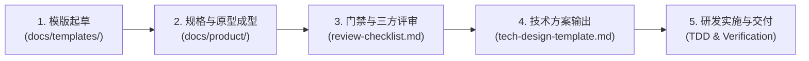

# 业务产品需求与交互原型库 (Product Specs & Prototypes)

欢迎查阅系统业务产品规范与原型管理仓库。本目录用于沉淀具体业务特性的**企业级产品需求规格说明书 (PRD)** 与 **高保真单文件交互原型 (Prototypes)**，作为产品、设计与全端研发团队之间的单一事实契约。

---

## 1. 目录结构与命名规范 (Directory & Naming Convention)

所有业务特性的文档与原型文件统一遵循 **“3 位顺序编号 + 语义化特性英文简写 (kebab-case)”** 的强映射规范：

```text
docs/product/
├── README.md                      # 本导航索引与协同工作规范
├── specs/                         # 业务需求规格书 (Markdown PRD)
│   └── 001-mfa-security-center.md # 特性规格说明书
└── prototypes/                    # 交互原型文件 (Self-Contained HTML)
    └── 001-mfa-security-center.html # 对应的零构建高保真交互原型
```

> 📌 **一一对应原则**：每一个进入开发流程的业务特性，`specs/` 下的规格书与 `prototypes/` 下的原型文件必须保持同名编号与协同演进。

---

## 2. 标准协作工作流 (Product Delivery Workflow)



1. **Step 1: 复制模版起草**：
   - 复制 `docs/templates/prd-template.md` 至 `docs/product/specs/<ID>-<name>.md`；
   - 复制 `docs/templates/prototype-template.html` 至 `docs/product/prototypes/<ID>-<name>.html`；
2. **Step 2: 填充规格与原型交互**：
   - 产品经理细化业务背景、流程图、状态机与字段规则；
   - 交互设计师在 HTML 原型中配置界面结构、响应式表单校验与微动效；
3. **Step 3: 需求评审门禁**：
   - 依据 `docs/templates/review-checklist.md` 进行三方（产品/研发/测试）评审，全票勾选后定稿；
4. **Step 4: 技术方案映射**：
   - 后端与前端技术负责人根据定稿 PRD 产出技术设计文档 (TRD)；
5. **Step 5: 研发与自动化验证**：
   - 按照规格书验收标准编写单元测试与业务代码，保障 100% 契约保真。

---

## 3. 当前已沉淀业务特性清单 (Product Portfolio)

| 编号 | 特性名称 | 业务领域 | 当前状态 | 需求规格书 (PRD) | 高保真交互原型 (Prototype) |
| :--- | :--- | :--- | :--- | :--- | :--- |
| **001** | **用户安全中心与双因素认证 (2FA)** | 身份与访问安全 (Auth) | **已定稿 (Approved)** | [001-mfa-security-center.md](./specs/001-mfa-security-center.md) | [001-mfa-security-center.html](./prototypes/001-mfa-security-center.html) |
| *002* | *多租户组织管理与成员邀请流* | 租户隔离与协作 (Org) | 待规划 (Draft) | *(待创建)* | *(待创建)* |
| *003* | *实时白板与协同在场感知* | 实时通信中枢 (Realtime) | 待规划 (Draft) | *(待创建)* | *(待创建)* |

---

## 4. 相关参考与标准模板

- [全生命周期企业级 PRD 模版](../templates/prd-template.md)
- [交互原型设计与标注规范](../templates/prototype-guidelines.md)
- [开箱即用交互原型脚手架 HTML](../templates/prototype-template.html)
- [技术架构与系统详细设计规格书 (TRD) 模版](../templates/tech-design-template.md)
- [需求评审与验收 Definition of Done (DoD) 清单](../templates/review-checklist.md)
