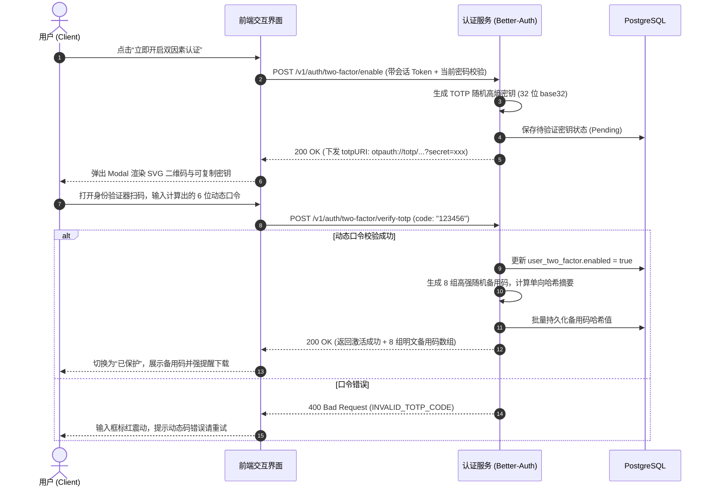
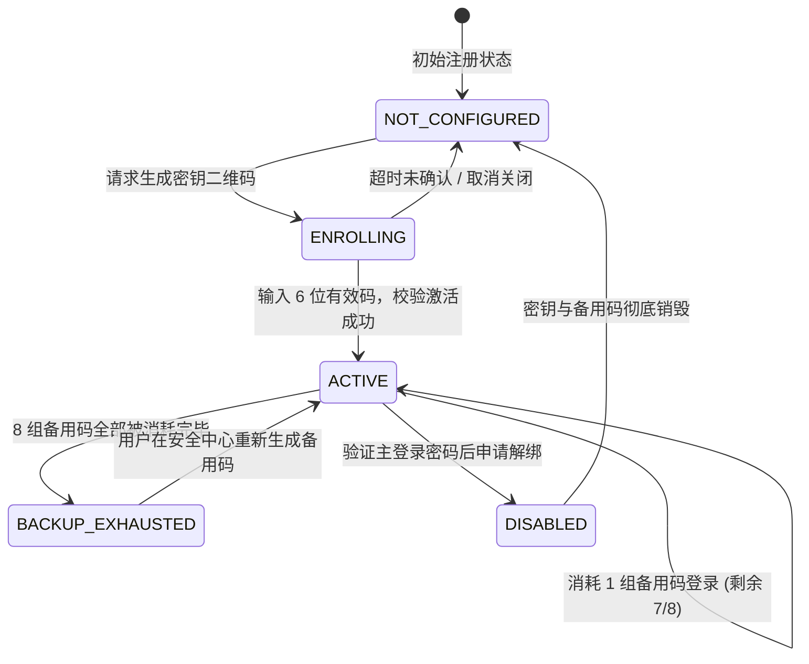

# 001 - 用户安全中心与双因素认证 (2FA) 产品需求规格书 (PRD)

> **特性编号**：FEAT-AUTH-001  
> **文档状态**：Approved（已定稿）  
> **当前版本**：v1.0.0  
> **制定日期**：2026-09-11  
> **关联原型**：[001-mfa-security-center.html](../prototypes/001-mfa-security-center.html)  

---

## 0. 核心协同团队与版本履历 (Metadata & Revision)

### 0.1 核心干系人表

| 角色 | 负责人 | 所在团队 | 职责说明 |
| :--- | :--- | :--- | :--- |
| **产品负责人 (PM)** | 业务安全 PM 组 | 账号安全产品线 | 需求规格定义、业务转化与合规验收 |
| **技术负责人 (Tech Lead)** | 架构师团队 | 后端研发组 | 负责底层 Better-Auth TwoFactor 插件集成与数据持久化 |
| **前端负责人 (Frontend)** | 客户端交互组 | 前端工程组 | Web/App 安全中心界面实现与 TOTP 扫码交互 |
| **质量保证 (QA Lead)** | 质量工程部 | 核心自动化测试组 | 负责全流程安全边界用例、重放攻击与锁定测试 |

### 0.2 版本修订记录

| 版本号 | 修订日期 | 修订人 | 变更类型 | 变更核心摘要 |
| :--- | :--- | :--- | :--- | :--- |
| **v1.0.0** | 2026-09-11 | 业务安全 PM 组 | Create | 确立基于 TOTP 的双因素认证、8 组一次性安全备用码与风控锁定规则 |

---

## 1. 需求背景与业务价值 (Context & Business Objectives)

### 1.1 问题陈述 (Problem Statement)

传统“用户名 + 密码”单因素凭据在面对撞库攻击、弱口令泄漏或钓鱼网站时防御极为脆弱。企业管理后台与核心 API 若遭口令泄漏，攻击者可直接越权访问甚至篡改系统数据。为此，必须在账号中心引入基于行业标准 RFC 6238 的**基于时间的一次性密码 (TOTP, Time-based One-Time Password)** 双因素认证体系。

### 1.2 商业与合规价值 (Business Value)

1. **合规对齐**：满足等保三级与 SOC2 对特权账号强制实施双因素认证的硬性审计要求；
2. **资产保障**：杜绝 99.9% 凭据盗用引发的越权入侵风险；
3. **用户体验与安全平衡**：提供简单明了的二维码扫码绑定体验，配套应急恢复码 (Backup Codes) 消除因手机丢失导致的永久锁号问题。

### 1.3 核心成功衡量指标 (Success Metrics)

| 衡量维度 | 当前基线 (Baseline) | 目标值 (Target) | 统计口径与数据来源 |
| :--- | :--- | :--- | :--- |
| **特权管理员 2FA 渗透率** | 0% (新功能) | **100% (强制)** | `已开启 2FA 管理员数 / 全体管理员数` |
| **普通用户主动开启率** | 0% | ≥ 30% | 注册满 7 天活跃用户转化漏斗 |
| **首次绑定成功率** | - | ≥ 92% | `完成最终验证人数 / 点击开启二维码人数` |
| **登录二次校验时延** | - | ≤ 200ms | 动态口令比对服务端耗时 P99 |

### 1.4 本期明确不做的事项目 (Non-Goals)

- ❌ **不做**：SMS 短信二次校验（短信通道成本高且易遭 SIM 卡劫持，后续视需求拓展）；
- ❌ **不做**：FIDO2 物理硬件 U 盾钥匙认证（规划在 Phase 2 WebAuthn/Passkey 统一上线）。

---

## 2. 用户角色画像与核心用例 (Personas & User Stories)

### 2.1 目标角色定义

- **企业特权管理员 (Super Admin / Admin)**：掌握全站数据读写权限，属于高危防攻击靶标，系统将强制引导在首周内完成 2FA 绑定；
- **普通注册用户 (General User)**：对安全敏感、希望主动保护个人资产与账户隐私的终端用户。

### 2.2 用户故事集 (User Stories)

| 编号 | 用户故事描述 | 验收标准简要 | 优先级 |
| :--- | :--- | :--- | :--- |
| **US-01** | 作为登录用户，我希望在“个人设置 > 安全中心”中开启 2FA，并使用手机验证器 App 扫描屏幕二维码完成配置。 | 展示二维码与明文 Secret，输入 6 位有效动态码后成功激活并切换状态为“已保护”。 | **P0** |
| **US-02** | 作为已开启 2FA 用户，我希望在激活成功后立即获得 8 组一次性安全备用恢复码，并能一键复制或下载文本保存。 | 弹窗展示 8 组独立格式（形如 `xxxx-xxxx`）代码，提供“复制到剪贴板”与“下载 txt”按钮。 | **P0** |
| **US-03** | 作为开启 2FA 用户，在登录时若无法使用手机验证器，我希望输入任意一组未消耗的备用码完成临时登录。 | 校验备用码有效性，核销消耗当前备用码并记录审计日志。 | **P0** |
| **US-04** | 作为想要更换设备或解绑的用户，我希望在安全中心停用 2FA，但系统必须强制验证我的主账户密码。 | 输入当前登录密码正确后方可关闭，防止电脑暂离时被他人恶意解绑。 | **P1** |

---

## 3. 业务流程与状态生命周期 (Business Flows & State Machine)

### 3.1 首次开启与激活时序图 (Enable Sequence)

### 3.2 双因素安全凭据生命周期 (State Machine)

---

## 4. 详细功能规格与交互规则 (Functional Specifications)

### 4.1 原型页面结构索引

本功能对应的高保真原型单页位于：[001-mfa-security-center.html](../prototypes/001-mfa-security-center.html)。
包含三个核心信息模块：

1. **安全状态概览卡片**：展示当前防护级别（基础密码保护 vs 双因素强化防护），状态 Tag（未开启 / 已保护 / 锁定）；
2. **配置与操作交互区**：
   - 未开启态：展示安全优势与“立即配置”主按键；
   - 已开启态：展示已绑定验证器、备用恢复码管理（查看剩余数量、重新生成）与“停用保护”按键。
3. **安全操作审计流**：记录近期的 2FA 绑定、备用码消耗、尝试失败等审计流水。

### 4.2 字段校验规则矩阵

| 字段名称 | 参数键名 | 类型 | 必填 | 客户端输入校验规范 | 服务端处理逻辑与约束 | 错误提示文案 |
| :--- | :--- | :--- | :--- | :--- | :--- | :--- |
| **动态验证码** | `code` | `String` | 是 | 纯 6 位数字，自动剥离前后空格与短横杠 | 结合当前服务端 UTC 时间戳比对（容忍前后 1 个步长，±30s） | “请输入 6 位有效动态口令” |
| **登录验证密码** | `password` | `String` | 是 | 8~64 位字符，用于安全解绑或初次开启时二次验证身份 | Argon2id 恒定时间密码比对 | “账户主密码不匹配，请重新确认” |
| **备用恢复码** | `backupCode` | `String` | 否 | 格式为 8~10 位英数混合字符 | 规范化后计算哈希，查询匹配记录并将 `used` 置为 true | “该备用恢复码无效或已被核销” |

### 4.3 关键异常与防御性交互

1. **时钟偏差防御 (Clock Skew)**：
   - 服务端 TOTP 校验算法默认开放 `±1` 个窗口（即允许客户端手机时间与服务端存在至多 30 秒偏差）；
2. **暴力破解频控与锁定 (Rate Limiting & Lockout)**：
   - 单账户 15 分钟内连续输错 5 次动态口令，冻结 2FA 校验 15 分钟，返回 HTTP 429；前端展示冷却倒计时并提示“请稍后再试或联系安全管理员”；
3. **备用码唯一展示原则 (One-time Display)**：
   - 8 组明文备用恢复码仅在“初次激活成功”与“重新生成备用码”时刻展示一次，数据库端仅持久化哈希摘要；关闭弹窗后无法再次查阅明文，只能废弃重新生成。

---

## 5. 非功能指标与安全规范 (NFR & Security)

### 5.1 性能与吞吐 SLA

- **校验耗时**：动态口令验证接口 P95 响应时延 ≤ 100ms；
- **并发承载**：支持峰值登录并发 QPS ≥ 200，校验过程无长连接阻塞。

### 5.2 核心安全红线

- 🔒 **密钥密文隔离**：TOTP Secret 必须以加密字段入库，严禁日志明文输出；
- 🔒 **会话提权防护 (Sudo Mode)**：开启或解绑 2FA 必须依赖高新鲜度凭据（过去 5 分钟内输入过主密码），杜绝 XSS 劫持活跃 Cookie 后直接解绑 2FA。

### 5.3 业务埋点字典

| 事件标识 | 触发时机 | 关键上报属性 | 埋点目的 |
| :--- | :--- | :--- | :--- |
| `sec_2fa_page_view` | 用户进入安全中心页面 | `user_id`, `current_status` | 曝光漏斗基准 |
| `sec_2fa_setup_start` | 用户点击开启打开扫码弹窗 | `user_id`, `client_platform` | 转化率漏斗步骤 1 |
| `sec_2fa_setup_success` | 首次校验 6 位码激活成功 | `user_id`, `duration_ms` | 核心开通成功率 |
| `sec_2fa_backup_copied`| 用户点击复制或下载备用码 | `user_id`, `action: 'copy'|'download'` | 备用凭证妥善留存率 |
| `sec_2fa_disable` | 用户解绑 2FA 成功 | `user_id`, `reason_category` | 留存与流失预警分析 |

---

## 6. 交付验收与测试基准 (Acceptance Checklist)

- [ ] **Google Authenticator 与 iOS 密码验证器兼容测试**：扫码后能正确识别 Issuer 与账户名并稳定生成有效口令；
- [ ] **备用码一次性核销测试**：使用第 1 组备用码登录成功后，再次输入相同备用码必须返回已被消耗；
- [ ] **暴力试错锁定测试**：连续 5 次输入错误动态码，账户进入 15 分钟临时锁定态；
- [ ] **防越权测试**：尝试调用解绑接口修改其他用户 `userId`，服务端必须返回 403 Forbidden；
- [ ] **单测全绿门禁**：新增的业务 Service、DTO 校验与 Controller 端点单元测试覆盖率达 100%。
