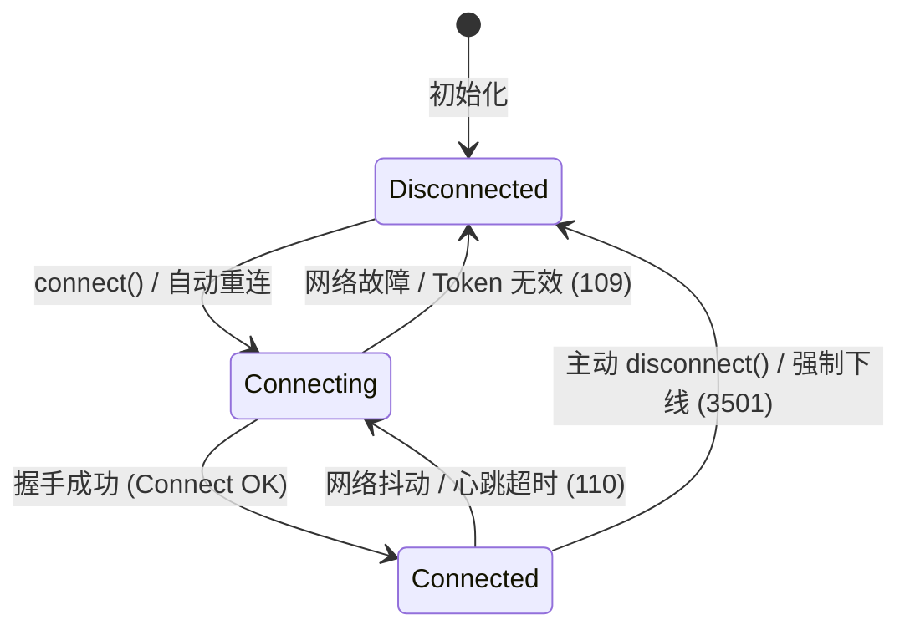

# 实时通信 WebSocket 客户端接入指南

> 本文档面向 Web、移动端（iOS / Android / Flutter）、微信小程序以及桌面端开发团队，规定了接入实时通信中枢的 **WebSocket 全功能通信协议**、长连接生命周期管理、多频道订阅与在场感知 (Presence)、**4 大核心客户端平台生产级实现**（**TypeScript**、**Dart / Flutter**、**Android / Kotlin**、**微信小程序原生**）以及 **Bruno WebSocket 联调测试规范**。

---

## 1. WebSocket 架构与生命周期 (Connection Lifecycle)

系统采用 **Centrifugo (v5)** 作为分布式实时消息网关。WebSocket 是推荐的**主力全功能通信协议**，支持在单一物理 TCP 长连接上实现**频道多路复用**、**断网自愈与离线消息自动恢复 (Publication Recovery)** 以及 **在场成员感知 (Presence)**。

### 1.1 服务端点信息

| 环境 | 物理 WebSocket 端点 | 反向代理路径 (WSS) |
| :--- | :--- | :--- |
| **本地联调** | `ws://localhost:8000/connection/websocket` | - |
| **生产环境** | - | `wss://api.yourdomain.com/connection/websocket` |

---

### 1.2 连接状态机 (State Machine)

客户端长连接具备以下标准状态生命周期：



1. **Disconnected (已断开)**：初始状态或调用 `disconnect()` 后的休眠状态。
2. **Connecting (连接中)**：客户端向业务后端换取 Connection Token，并向网关发起 WebSocket 握手。
3. **Connected (已连接)**：网关验签通过，分配唯一 `client_id`，客户端可以开始订阅频道或接收推送。
4. **离线自动恢复 (Publication Recovery)**：当因移动网络切换等原因短暂断开重连时，网关通过比较消息 `offset` / `epoch` 自动向客户端补发断网期间未接收的历史消息。

---

## 2. 频道订阅与协同能力 (Channels & Presence)

在 WebSocket 连接就绪后，客户端可通过多路复用（Multiplexing）同时订阅多个频道，无需建立多条连接。

### 2.1 频道分类与准入规则

| 频道前缀 | 鉴权机制 | 客户端换票要求 | 典型场景 |
| :--- | :--- | :--- | :--- |
| **`user#${userId}`** | 网关本地验签 | **无需申请 Token**，网关直接比对 `userId === JWT.sub` | 个人通知红点、私信、审批流转、被踢下线通知 |
| **`public:${name}`** | 全网公开可读 | **无需申请 Token**，合法长连接均可订阅 | 系统维护公告、全员广播 |
| **`room:${roomId}`** | 动态换票 | **必须向业务 API 换取** `Subscription Token` | 协同白板、聊天室、看板多人协作、在线名单 |
| **`admin:${topic}`** | 角色强校验 | **必须具备管理员权限** 向业务 API 换取准入票据 | 实时监控大屏、服务器实时告警指标 |

> 🔒 **客户端发布安全红线**：
> 客户端**严禁直接通过 WebSocket 向频道推送业务消息**（网关配置 `publish: false`）。所有消息写入必须通过业务 RESTful API 提交，经后端权限校验与业务编排后统一向网关广播，杜绝客户端伪造事件。

---

## 3. 多端客户端生产级推荐实例 (Recommended Implementations)

---

### 3.1 推荐实例 1：TypeScript (Web / Node / Electron)

采用官方主流 SDK [centrifuge-js (v5)](https://github.com/centrifugal/centrifuge-js)。

#### 1. 安装依赖

```bash
pnpm add centrifuge
# 或 npm install centrifuge
```

#### 2. 生产级封装 (`RealtimeClient.ts`)

```typescript
import { Centrifuge, type Subscription, type PublicationContext } from 'centrifuge';

export interface RealtimeConfig {
  wsUrl: string;
  apiBaseUrl: string;
  getAuthToken: () => string | Promise<string>;
  onUnauthorized?: () => void;
}

export interface RealtimeEnvelope<T = unknown> {
  event: string;
  channel?: string;
  targetUserId?: string;
  data: T;
  timestamp: number;
}

export class RealtimeClient {
  private client: Centrifuge;
  private config: RealtimeConfig;

  constructor(config: RealtimeConfig) {
    this.config = config;

    this.client = new Centrifuge(config.wsUrl, {
      // 自动获取与刷新 Connection JWT
      getToken: async () => {
        const authToken = await this.config.getAuthToken();
        const res = await fetch(`${this.config.apiBaseUrl}/v1/realtime/token`, {
          headers: {
            Authorization: `Bearer ${authToken}`,
            'Content-Type': 'application/json',
          },
        });

        if (!res.ok) {
          if (res.status === 401) this.config.onUnauthorized?.();
          throw new Error(`获取长连接凭证失败: HTTP ${res.status}`);
        }

        const data = await res.json();
        return data.token;
      },
      minReconnectDelay: 1000,
      maxReconnectDelay: 20000,
      maxServerPingDelay: 10000,
    });

    this.initLifecycle();
  }

  private initLifecycle() {
    this.client.on('connecting', (ctx) => console.info('[Realtime] 正在连接网关...', ctx.reason));
    this.client.on('connected', (ctx) => console.info('[Realtime] 网关已连接! Client ID:', ctx.client));
    this.client.on('disconnected', (ctx) => console.warn('[Realtime] 连接断开:', ctx.reason));
    this.client.on('error', (ctx) => console.error('[Realtime] 客户端异常:', ctx.error));
  }

  public connect() {
    this.client.connect();
  }

  public disconnect() {
    this.client.disconnect();
  }

  public getClientId(): string {
    return this.client.getClientId();
  }

  /**
   * 订阅用户专属通知频道 (user#userId) - 免申请 Token
   */
  public subscribeUser(userId: string, onMessage: (envelope: RealtimeEnvelope) => void): Subscription {
    const sub = this.client.newSubscription(`user#${userId}`);
    sub.on('publication', (ctx: PublicationContext) => onMessage(ctx.data as RealtimeEnvelope));
    sub.on('subscribed', (ctx) => console.info(`[Realtime] 个人频道已就绪, 离线恢复: ${ctx.recovered}`));
    sub.subscribe();
    return sub;
  }

  /**
   * 订阅公开广播频道 (public:name)
   */
  public subscribePublic(name: string, onMessage: (envelope: RealtimeEnvelope) => void): Subscription {
    const sub = this.client.newSubscription(`public:${name}`);
    sub.on('publication', (ctx: PublicationContext) => onMessage(ctx.data as RealtimeEnvelope));
    sub.subscribe();
    return sub;
  }

  /**
   * 订阅受限协作房间频道 (room:roomId) - 自动动态换票，支持 Presence
   */
  public subscribeRoom(
    roomId: string,
    options: {
      onMessage: (envelope: RealtimeEnvelope) => void;
      onJoin?: (info: unknown) => void;
      onLeave?: (info: unknown) => void;
    },
  ): Subscription {
    const sub = this.client.newSubscription(`room:${roomId}`, {
      getToken: async (ctx) => {
        const authToken = await this.config.getAuthToken();
        const res = await fetch(`${this.config.apiBaseUrl}/v1/realtime/subscribe`, {
          method: 'POST',
          headers: {
            Authorization: `Bearer ${authToken}`,
            'Content-Type': 'application/json',
          },
          body: JSON.stringify({
            channel: ctx.channel,
            client: this.client.getClientId(),
          }),
        });

        if (!res.ok) throw new Error(`申请房间凭证失败: HTTP ${res.status}`);
        const data = await res.json();
        return data.token;
      },
    });

    sub.on('publication', (ctx: PublicationContext) => options.onMessage(ctx.data as RealtimeEnvelope));
    if (options.onJoin) sub.on('join', (ctx) => options.onJoin!(ctx.info));
    if (options.onLeave) sub.on('leave', (ctx) => options.onLeave!(ctx.info));

    sub.subscribe();
    return sub;
  }
}
```

---

### 3.2 推荐实例 2：Dart (Flutter 移动端)

采用官方 [centrifuge-dart](https://pub.dev/packages/centrifuge) 库。

#### 1. 添加依赖 (`pubspec.yaml`)

```yaml
dependencies:
  centrifuge: ^0.14.0
  http: ^1.2.0
```

#### 2. Flutter 实时通信服务 (`realtime_service.dart`)

```dart
import 'dart:async';
import 'dart:convert';
import 'package:centrifuge/centrifuge.dart' as centrifuge;
import 'package:http/http.dart' as http;

class RealtimeService {
  late centrifuge.Client _client;
  final String wsUrl;
  final String apiBaseUrl;
  final Future<String> Function() getAuthToken;

  RealtimeService({
    required this.wsUrl,
    required this.apiBaseUrl,
    required this.getAuthToken,
  });

  /// 初始化并建立连接
  Future<void> init() async {
    final authToken = await getAuthToken();
    final res = await http.get(
      Uri.parse('$apiBaseUrl/v1/realtime/token'),
      headers: {'Authorization': 'Bearer $authToken'},
    );

    if (res.statusCode != 200) {
      throw Exception('获取连接凭据失败: HTTP ${res.statusCode}');
    }

    final connectionToken = jsonDecode(res.body)['token'] as String;

    _client = centrifuge.createClient(
      wsUrl,
      centrifuge.ClientConfig(
        token: connectionToken,
        getToken: (event) async {
          final refreshedAuthToken = await getAuthToken();
          final refreshRes = await http.get(
            Uri.parse('$apiBaseUrl/v1/realtime/token'),
            headers: {'Authorization': 'Bearer $refreshedAuthToken'},
          );
          return jsonDecode(refreshRes.body)['token'] as String;
        },
      ),
    );

    _client.connected.listen((event) {
      print('[Realtime] Flutter 长连接已建立: client=${event.client}');
    });

    _client.disconnected.listen((event) {
      print('[Realtime] Flutter 连接断开: reason=${event.reason}');
    });

    await _client.connect();
  }

  /// 订阅个人专属频道 (user#userId)
  centrifuge.Subscription subscribeUser(
    String userId,
    void Function(Map<String, dynamic> data) onMessage,
  ) {
    final sub = _client.newSubscription('user#$userId');

    sub.publication.listen((event) {
      final payload = jsonDecode(utf8.decode(event.data)) as Map<String, dynamic>;
      onMessage(payload);
    });

    sub.subscribe();
    return sub;
  }

  /// 订阅协同房间频道 (room:roomId)
  Future<centrifuge.Subscription> subscribeRoom({
    required String roomId,
    required void Function(Map<String, dynamic> data) onMessage,
    void Function(dynamic user)? onJoin,
    void Function(dynamic user)? onLeave,
  }) async {
    final channel = 'room:$roomId';
    final authToken = await getAuthToken();

    final res = await http.post(
      Uri.parse('$apiBaseUrl/v1/realtime/subscribe'),
      headers: {
        'Authorization': 'Bearer $authToken',
        'Content-Type': 'application/json',
      },
      body: jsonEncode({
        'channel': channel,
        'client': _client.clientId,
      }),
    );

    if (res.statusCode != 200) {
      throw Exception('获取房间准入凭据失败: HTTP ${res.statusCode}');
    }

    final subToken = jsonDecode(res.body)['token'] as String;

    final sub = _client.newSubscription(
      channel,
      centrifuge.SubscriptionConfig(token: subToken),
    );

    sub.publication.listen((event) {
      final payload = jsonDecode(utf8.decode(event.data)) as Map<String, dynamic>;
      onMessage(payload);
    });

    if (onJoin != null) sub.join.listen((event) => onJoin(event.info));
    if (onLeave != null) sub.leave.listen((event) => onLeave(event.info));

    sub.subscribe();
    return sub;
  }

  void dispose() {
    _client.disconnect();
  }
}
```

---

### 3.3 推荐实例 3：Android (Kotlin 原生开发)

采用官方 [centrifuge-java](https://github.com/centrifugal/centrifuge-java) 并在 Kotlin 协程调度下运行。

#### 1. 引入 Gradle 依赖 (`app/build.gradle.kts`)

```kotlin
dependencies {
    implementation("io.github.centrifugal:centrifuge-java:0.4.1")
    implementation("com.squareup.okhttp3:okhttp:4.12.0")
    implementation("org.jetbrains.kotlinx:kotlinx-coroutines-android:1.8.0")
}
```

#### 2. 原生封装 (`RealtimeManager.kt`)

```kotlin
package com.app.realtime

import android.util.Log
import io.github.centrifugal.centrifuge.*
import kotlinx.coroutines.*
import okhttp3.MediaType.Companion.toMediaType
import okhttp3.OkHttpClient
import okhttp3.Request
import okhttp3.RequestBody.Companion.toRequestBody
import org.json.JSONObject
import java.nio.charset.StandardCharsets

class RealtimeManager(
    private val wsUrl: String,
    private val apiBaseUrl: String,
    private val getAuthToken: suspend () -> String
) {
    private val TAG = "RealtimeManager"
    private val httpClient = OkHttpClient()
    private val scope = CoroutineScope(Dispatchers.IO + SupervisorJob())
    private var client: Client? = null

    fun connect() {
        scope.launch {
            try {
                val connectionToken = fetchConnectionToken()
                val options = Options().apply {
                    token = connectionToken
                }

                client = Client(wsUrl, options, object : EventListener() {
                    override fun onConnected(client: Client, event: ConnectedEvent) {
                        Log.i(TAG, "Centrifugo 已连接! Client ID: ${event.client}")
                    }

                    override fun onDisconnected(client: Client, event: DisconnectedEvent) {
                        Log.w(TAG, "Centrifugo 连接断开: ${event.reason}")
                    }

                    override fun onError(client: Client, event: ErrorEvent) {
                        Log.e(TAG, "Centrifugo 异常: ${event.error.message}")
                    }
                })

                client?.connect()
            } catch (e: Exception) {
                Log.e(TAG, "连接初始化失败", e)
            }
        }
    }

    fun subscribeUser(userId: String, onMessage: (JSONObject) -> Unit): Subscription? {
        val channel = "user#$userId"
        val sub = client?.newSubscription(channel, SubscriptionOptions(), object : SubscriptionEventListener() {
            override fun onPublication(sub: Subscription, event: PublicationEvent) {
                val jsonString = String(event.data, StandardCharsets.UTF_8)
                onMessage(JSONObject(jsonString))
            }

            override fun onSubscribed(sub: Subscription, event: SubscribedEvent) {
                Log.i(TAG, "订阅个人频道成功, 离线恢复: ${event.recovered}")
            }

            override fun onError(sub: Subscription, event: SubscriptionErrorEvent) {
                Log.e(TAG, "订阅个人频道异常: ${event.error.message}")
            }
        })
        sub?.subscribe()
        return sub
    }

    fun subscribeRoom(
        roomId: String,
        onMessage: (JSONObject) -> Unit,
        onJoin: ((JSONObject) -> Unit)? = null,
        onLeave: ((JSONObject) -> Unit)? = null
    ) {
        scope.launch {
            val channel = "room:$roomId"
            val clientId = client?.clientId ?: return@launch
            val subToken = fetchSubscriptionToken(channel, clientId)

            val subOptions = SubscriptionOptions().apply {
                token = subToken
            }

            val sub = client?.newSubscription(channel, subOptions, object : SubscriptionEventListener() {
                override fun onPublication(sub: Subscription, event: PublicationEvent) {
                    val jsonString = String(event.data, StandardCharsets.UTF_8)
                    onMessage(JSONObject(jsonString))
                }

                override fun onJoin(sub: Subscription, event: JoinEvent) {
                    val userObj = JSONObject().apply {
                        put("user", event.info.user)
                        put("client", event.info.client)
                    }
                    onJoin?.invoke(userObj)
                }

                override fun onLeave(sub: Subscription, event: LeaveEvent) {
                    val userObj = JSONObject().apply {
                        put("user", event.info.user)
                    }
                    onLeave?.invoke(userObj)
                }
            })
            sub?.subscribe()
        }
    }

    private suspend fun fetchConnectionToken(): String = withContext(Dispatchers.IO) {
        val authToken = getAuthToken()
        val request = Request.Builder()
            .url("$apiBaseUrl/v1/realtime/token")
            .addHeader("Authorization", "Bearer $authToken")
            .get()
            .build()

        httpClient.newCall(request).execute().use { response ->
            if (!response.isSuccessful) throw IllegalStateException("获取连接凭据失败: ${response.code}")
            val body = response.body?.string() ?: ""
            JSONObject(body).getString("token")
        }
    }

    private suspend fun fetchSubscriptionToken(channel: String, client: String): String = withContext(Dispatchers.IO) {
        val authToken = getAuthToken()
        val payload = JSONObject().apply {
            put("channel", channel)
            put("client", client)
        }

        val request = Request.Builder()
            .url("$apiBaseUrl/v1/realtime/subscribe")
            .addHeader("Authorization", "Bearer $authToken")
            .post(payload.toString().toRequestBody("application/json".toMediaType()))
            .build()

        httpClient.newCall(request).execute().use { response ->
            if (!response.isSuccessful) throw IllegalStateException("获取频道凭证失败: ${response.code}")
            val body = response.body?.string() ?: ""
            JSONObject(body).getString("token")
        }
    }

    fun disconnect() {
        client?.disconnect()
        scope.cancel()
    }
}
```

---

### 3.4 推荐实例 4：微信小程序 (WeChat Mini Program - 零依赖原生)

微信小程序运行于定制 JS 容器中，**不支持浏览器标准 `WebSocket` 构造函数**。推荐使用以下基于微信原生 `wx.connectSocket` / `SocketTask` 的工业级生产封装，**无需安装任何第三方 npm 包**，内建自动重连、心跳保活和完整的 Centrifugo 协议帧管理。

> ⚠️ **微信公众平台配置提醒**：
> 正式上线前，必须在微信公众平台「开发管理 -> 开发设置 -> 服务器域名」中将实时网关地址配置在 **`socket 合法域名`**（必须为 `wss://` 前缀）以及 **`request 合法域名`** 中。

#### 微信小程序专用客户端 (`wechat-realtime-client.ts`)

```typescript
export interface WechatRealtimeOptions {
  wsUrl: string; // 如 wss://api.yourdomain.com/connection/websocket
  apiBaseUrl: string; // 如 https://api.yourdomain.com
  getAuthToken: () => Promise<string>;
}

export interface RealtimeEnvelope<T = unknown> {
  event: string;
  channel?: string;
  targetUserId?: string;
  data: T;
  timestamp: number;
}

export class WechatRealtimeClient {
  private socketTask: WechatMiniprogram.SocketTask | null = null;
  private commandId = 1;
  private clientId: string | null = null;
  private isConnected = false;
  private isManualClose = false;
  private reconnectAttempts = 0;
  private reconnectTimer: number | null = null;
  private pingIntervalTimer: number | null = null;

  // 频道回调映射: channel -> Array<(envelope: RealtimeEnvelope) => void>
  private subscriptions = new Map<string, Array<(envelope: RealtimeEnvelope) => void>>();

  constructor(private options: WechatRealtimeOptions) {}

  /**
   * 发起连接
   */
  public async connect(): Promise<void> {
    this.isManualClose = false;

    // 1. 调用后端 REST 接口获取 Connection JWT
    let connectionToken: string;
    try {
      connectionToken = await this.fetchConnectionToken();
    } catch (err) {
      console.error('[WechatRealtime] 获取 Connection Token 失败:', err);
      this.scheduleReconnect();
      return;
    }

    // 2. 建立原生微信 Socket
    this.socketTask = wx.connectSocket({
      url: this.options.wsUrl,
      protocols: ['centrifuge-json'], // Centrifugo 标准 JSON 子协议
      success: () => console.info('[WechatRealtime] Socket 创建指令已下发'),
      fail: (err) => {
        console.error('[WechatRealtime] Socket 创建失败:', err);
        this.scheduleReconnect();
      },
    });

    this.bindSocketEvents(connectionToken);
  }

  private bindSocketEvents(connectionToken: string) {
    if (!this.socketTask) return;

    // 连接已打开 -> 发送 Centrifugo 协议 Connect 握手帧
    this.socketTask.onOpen(() => {
      console.info('[WechatRealtime] TCP 连接就绪，发送 Connect 握手帧...');
      this.sendFrame({
        id: this.commandId++,
        connect: {
          token: connectionToken,
        },
      });
    });

    // 收到网关消息帧
    this.socketTask.onMessage((res) => {
      const text = typeof res.data === 'string' ? res.data : '';
      if (!text) return;

      // 处理心跳空对象 {}
      if (text === '{}') {
        this.sendPing();
        return;
      }

      try {
        const frame = JSON.parse(text);
        this.handleCentrifugoFrame(frame);
      } catch (e) {
        console.error('[WechatRealtime] 协议帧解析异常:', e, text);
      }
    });

    // 连接关闭
    this.socketTask.onClose((res) => {
      console.warn('[WechatRealtime] Socket 已关闭:', res.code, res.reason);
      this.cleanup();
      if (!this.isManualClose) {
        this.scheduleReconnect();
      }
    });

    // 发生网络错误
    this.socketTask.onError((err) => {
      console.error('[WechatRealtime] Socket 报错:', err);
      this.cleanup();
      if (!this.isManualClose) {
        this.scheduleReconnect();
      }
    });
  }

  /**
   * 处理网关响应帧
   */
  private handleCentrifugoFrame(frame: any) {
    // 1. 握手应答 (Connect Response)
    if (frame.connect) {
      this.clientId = frame.connect.client;
      this.isConnected = true;
      this.reconnectAttempts = 0;
      console.info('[WechatRealtime] 网关握手成功! ClientId:', this.clientId);

      // 开启本地保活心跳 (每 25 秒探测一次，防止微信 60s 闲置切断)
      this.startHeartbeat();

      // 重新订阅之前注册的频道
      this.resubscribeAll();
      return;
    }

    // 2. 接收服务端推送 (Publication Push)
    if (frame.pub) {
      const channel = frame.channel;
      const envelope = frame.pub.data as RealtimeEnvelope;
      const callbacks = this.subscriptions.get(channel) || [];
      callbacks.forEach((cb) => cb(envelope));
      return;
    }
  }

  /**
   * 订阅个人专属通知频道 (user#userId) - 免申请 Token
   */
  public subscribeUser(userId: string, onMessage: (envelope: RealtimeEnvelope) => void) {
    const channel = `user#${userId}`;
    this.registerCallback(channel, onMessage);

    if (this.isConnected) {
      this.sendFrame({
        id: this.commandId++,
        subscribe: { channel },
      });
    }
  }

  /**
   * 订阅协同房间频道 (room:roomId) - 动态向业务端申请 Token
   */
  public async subscribeRoom(roomId: string, onMessage: (envelope: RealtimeEnvelope) => void): Promise<void> {
    const channel = `room:${roomId}`;
    this.registerCallback(channel, onMessage);

    if (!this.isConnected || !this.clientId) {
      // 若尚未连接就绪，将在握手成功后的 resubscribeAll 中自动触发
      return;
    }

    const subToken = await this.fetchSubscriptionToken(channel, this.clientId);
    this.sendFrame({
      id: this.commandId++,
      subscribe: {
        channel,
        token: subToken,
      },
    });
  }

  private registerCallback(channel: string, cb: (env: RealtimeEnvelope) => void) {
    const list = this.subscriptions.get(channel) || [];
    list.push(cb);
    this.subscriptions.set(channel, list);
  }

  private async resubscribeAll() {
    for (const [channel] of this.subscriptions.entries()) {
      if (channel.startsWith('user#')) {
        this.sendFrame({ id: this.commandId++, subscribe: { channel } });
      } else if (channel.startsWith('room:') && this.clientId) {
        try {
          const token = await this.fetchSubscriptionToken(channel, this.clientId);
          this.sendFrame({ id: this.commandId++, subscribe: { channel, token } });
        } catch (e) {
          console.error(`[WechatRealtime] 恢复订阅频道 ${channel} 失败:`, e);
        }
      }
    }
  }

  private sendFrame(obj: any) {
    if (this.socketTask) {
      this.socketTask.send({
        data: JSON.stringify(obj),
      });
    }
  }

  private sendPing() {
    if (this.socketTask) {
      this.socketTask.send({ data: '{}' });
    }
  }

  private startHeartbeat() {
    this.stopHeartbeat();
    this.pingIntervalTimer = setInterval(() => {
      this.sendPing();
    }, 25000) as unknown as number;
  }

  private stopHeartbeat() {
    if (this.pingIntervalTimer) {
      clearInterval(this.pingIntervalTimer);
      this.pingIntervalTimer = null;
    }
  }

  private scheduleReconnect() {
    if (this.reconnectTimer) return;
    this.reconnectAttempts++;
    // 指数退避重连算法: min(1000 * 2^attempts, 20000)
    const delay = Math.min(1000 * Math.pow(2, this.reconnectAttempts), 20000);
    console.info(`[WechatRealtime] 将在 ${delay}ms 后进行第 ${this.reconnectAttempts} 次重连...`);

    this.reconnectTimer = setTimeout(() => {
      this.reconnectTimer = null;
      this.connect();
    }, delay) as unknown as number;
  }

  private cleanup() {
    this.isConnected = false;
    this.clientId = null;
    this.stopHeartbeat();
    this.socketTask = null;
  }

  public disconnect() {
    this.isManualClose = true;
    if (this.reconnectTimer) {
      clearTimeout(this.reconnectTimer);
      this.reconnectTimer = null;
    }
    this.cleanup();
    if (this.socketTask) {
      this.socketTask.close({ code: 1000, reason: 'Manual Disconnect' });
    }
  }

  private fetchConnectionToken(): Promise<string> {
    return new Promise(async (resolve, reject) => {
      const token = await this.options.getAuthToken();
      wx.request({
        url: `${this.options.apiBaseUrl}/v1/realtime/token`,
        method: 'GET',
        header: { Authorization: `Bearer ${token}` },
        success: (res) => {
          if (res.statusCode === 200) {
            resolve((res.data as any).token);
          } else {
            reject(new Error(`获取 Connection Token 失败: HTTP ${res.statusCode}`));
          }
        },
        fail: reject,
      });
    });
  }

  private fetchSubscriptionToken(channel: string, client: string): Promise<string> {
    return new Promise(async (resolve, reject) => {
      const token = await this.options.getAuthToken();
      wx.request({
        url: `${this.options.apiBaseUrl}/v1/realtime/subscribe`,
        method: 'POST',
        header: {
          Authorization: `Bearer ${token}`,
          'Content-Type': 'application/json',
        },
        data: { channel, client },
        success: (res) => {
          if (res.statusCode === 200) {
            resolve((res.data as any).token);
          } else {
            reject(new Error(`获取 Subscription Token 失败: HTTP ${res.statusCode}`));
          }
        },
        fail: reject,
      });
    });
  }
}
```

---

## 4. Bruno WebSocket 联调测试指南 (Bruno WebSocket Suite)

Centrifugo 使用基于 JSON 的消息协议帧。在 [Bruno](https://www.usebruno.com/) 中创建 **WebSocket Request**，填入 `{{wsUrl}}`（如 `ws://localhost:8000/connection/websocket`），可按如下标准帧步骤进行协议交互调试。

### 步骤 1：Connect 握手帧

连接建立后，向网关发送携带 `realtimeConnectionToken` 的握手帧：

```json
{
  "id": 1,
  "connect": {
    "token": "{{realtimeConnectionToken}}"
  }
}
```

**网关正常响应**：

```json
{
  "id": 1,
  "connect": {
    "client": "550e8400-e29b-41d4-a716-446655440000",
    "version": "5.4.0"
  }
}
```

---

### 步骤 2：订阅个人私有频道 (`user#${userId}`)

个人频道网关本地直接核验，无需携带 `token`：

```json
{
  "id": 2,
  "subscribe": {
    "channel": "user#{{userId}}"
  }
}
```

**网关正常响应**：

```json
{
  "id": 2,
  "subscribe": {
    "recovered": false
  }
}
```

---

### 步骤 3：订阅受限房间频道 (`room:${roomId}`)

携带从 `/v1/realtime/subscribe` 换取的 `realtimeSubscriptionToken`：

```json
{
  "id": 3,
  "subscribe": {
    "channel": "room:finance-q3",
    "token": "{{realtimeSubscriptionToken}}"
  }
}
```

---

### 步骤 4：接收实时事件信封推送 (Server Publication)

后端广播事件后，Bruno 实时接收到的推送帧格式：

```json
{
  "pub": {
    "data": {
      "event": "notification:created",
      "channel": "user#01918342-9999-7000-8000-000000000001",
      "targetUserId": "01918342-9999-7000-8000-000000000001",
      "data": {
        "id": "notif_1001",
        "title": "系统升级提醒",
        "unreadCount": 1
      },
      "timestamp": 1756140800000
    }
  },
  "channel": "user#01918342-9999-7000-8000-000000000001"
}
```

---

### 步骤 5：双向心跳保活帧

网关自动向客户端下发 `{}`，客户端直接回复 `{}` 即可完成心跳。

---

## 5. 错误码与排障矩阵 (Error Codes & Troubleshooting)

### 5.1 Centrifugo 网关错误码 (100~110)

| 错误码 | 错误名称 | 发生原因 | 客户端推荐恢复动作 |
| :--- | :--- | :--- | :--- |
| **100** | `Internal Error` | 网关内部异常 | 指数退避延迟重连。 |
| **102** | `Bad Request` | 连接参数格式错误或缺失 | 检查握手 URL 和 Token 格式。 |
| **103** | `Unknown Channel` | 订阅了网关未放行的非法频道前缀 | 检查频道拼写，确保符合 `user#`、`public:`、`room:`、`admin:` 命名规范。 |
| **105** | `Channel Limit Exceeded` | 单连接订阅频道数超过上限 | 检查客户端是否存在多次订阅未退订导致的泄漏。 |
| **109** | `Token Expired` | Connection 或 Subscription JWT 已过期 | **重新调用业务 API 获取新鲜 Token 并发起重连**。 |
| **110** | `Expired` | 连接因心跳超时断开 | SDK 内部会自动重连，移动端检查后台锁屏休眠网络状态。 |

---

### 5.2 WebSocket 断开状态码 (3000~3503)

| Close Code | 含义 | 是否自动重连 | 客户端说明与处理 |
| :--- | :--- | :--- | :--- |
| **3000** | `Normal Disconnect` | 否 | 客户端主动调用 `client.disconnect()`。 |
| **3001** | `Shutdown` | 是 | 网关服务器重启维护，客户端自动退避重连。 |
| **3501** | `Force Disconnect` | 否 | 用户被管理员强制下线，**客户端应清理本地会话并跳转登录页**。 |
| **3502** | `Force User Disconnect`| 否 | 同一账号在其他设备登录或密码变更失效，提示用户重新登录。 |
| **3503** | `Session Expired` | 否 | 会话过期，需刷新登录凭据。 |
