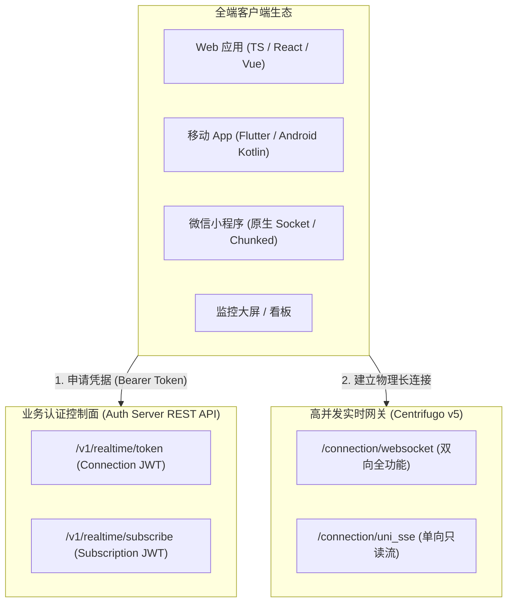
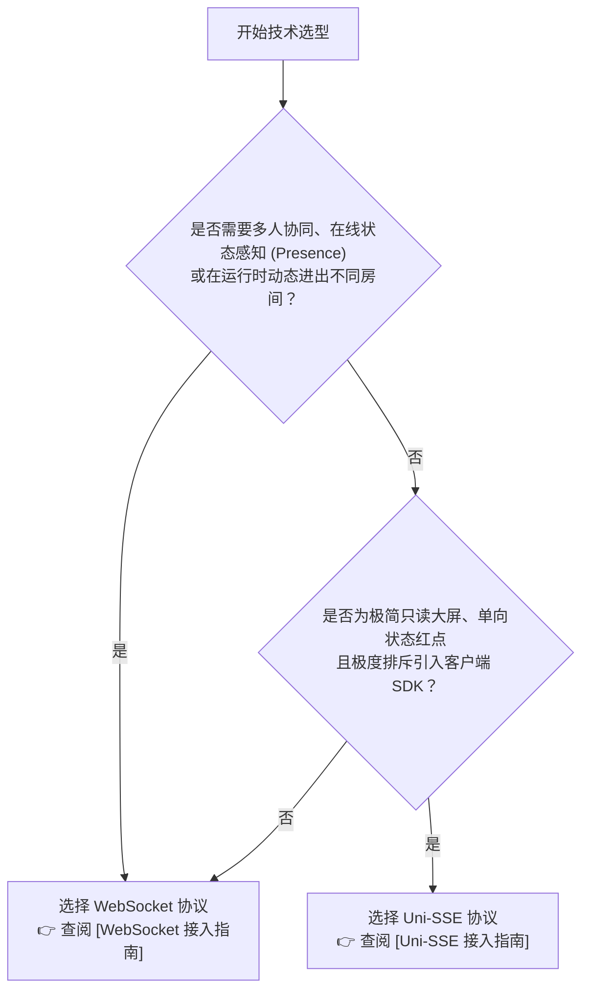

# 实时通信中枢架构与全端选型指南

> 本文档面向全端开发团队（Web 前端、iOS / Android 原生、Flutter 跨端、微信小程序以及后端与运维团队），作为实时通信系统的**顶层设计中枢、双协议选型决策树、鉴权 API 统一契约以及 Channel 拓扑治理规范**。

---

## 1. 架构总览与两阶段模型 (Architecture Overview)

系统实时通信基于高并发消息网关 **Centrifugo (v5)** 与 NestJS 领域事件发布服务构建，将**业务逻辑处理**与**长连接海量维持**彻底解耦。



客户端接入严格遵循 **“先向业务后端获取身份通行证，再与实时网关建立物理长连接”** 的两阶段模型：

1. **阶段一（鉴权）**：客户端向业务后端 REST API 出示业务登录凭据（Bearer Token），换取网关 Connection JWT 或特定受限频道的 Subscription JWT；
2. **阶段二（连接与订阅）**：客户端携带 JWT 连接 Centrifugo 网关，网关在本地基于共享 Secret 进行高速 HMAC-SHA256 验签，实现毫秒级准入与事件广播。

---

## 2. 协议选型决策树：WebSocket vs Uni-SSE (Protocol Decision Tree)

系统同时支持 **WebSocket** 与 **Uni-SSE (Server-Sent Events)** 两种长连接协议。开发者在工程选型时应参考以下准则：

### 2.1 深度特性对比矩阵

| 对比维度                   | WebSocket (全功能主力协议)                         | Uni-SSE (轻量单向流备选)                             | 架构选型指引                                    |
| :------------------------- | :------------------------------------------------- | :--------------------------------------------------- | :---------------------------------------------- |
| **首选占比**         | **95% 绝大多数业务场景**                     | **5% 边缘极简场景**                            | 默认一律优先选用 WebSocket。                    |
| **通信能力**         | 双向控制通道（支持 ping/pong、动态换票）           | 严格单向下行流 (Server -> Client)                    | 需要双向状态同步时必须选 WebSocket。            |
| **多路复用能力**     | **动态复用**（单连接订阅/退订任意频道）      | ❌**静态固定**（连接时定死频道，无法动态追加） | 涉及个人通知 + 多个业务房间时必须选 WebSocket。 |
| **协同在场感知**     | **完整支持 Presence**（在线名单与进出感知）  | ❌**完全不支持**                               | 聊天室、协同文档、协同白板必须选 WebSocket。    |
| **断线恢复机制**     | **Publication Recovery**（自动补发未读消息） | ⚠️ 依赖 HTTP 重连                                  | 移动端、弱网环境优先选 WebSocket。              |
| **连接数与并发限制** | **全局仅 1 条长连接**                        | ⚠️ HTTP/1.1 下单域名最多 6 个连接                  | 打开多 Tab 页面时 SSE 容易耗尽并发连接池。      |
| **客户端 SDK 要求**  | 推荐使用对应平台 SDK（或零依赖协议封装）           | 浏览器原生`EventSource` / 小程序分块传输           | 追求极简免装包只读大屏时可选 Uni-SSE。          |

### 2.2 决策路径



---

## 3. 鉴权与凭证申请 API 契约 (Authentication APIs)

无论客户端采用何种协议，均通过以下标准 RESTful API 换取访问凭据。

### 3.1 获取长连接通行证 (Connection Token)

- **HTTP 方法**：`GET`
- **请求 URL**：`/v1/realtime/token`
- **请求头**：`Authorization: Bearer <user_access_token>`

#### 响应载荷 (200 OK)

```json
{
  "token": "eyJhbGciOiJIUzI1NiIsInR5cCI6IkpXVCJ9...",
  "expiresAt": "2026-09-12T06:00:00.000Z",
  "user": {
    "id": "01918342-9999-7000-8000-000000000001",
    "name": "Alex",
    "avatar": "https://cdn.example.com/avatar.webp",
    "roles": ["USER"]
  }
}
```

| 字段          | 类型       | 说明                                                                                              |
| :------------ | :--------- | :------------------------------------------------------------------------------------------------ |
| `token`     | `string` | Connection JWT 凭据，用于 WebSocket 握手或 SSE`cf_connect` 参数。默认有效期 **24 小时**。 |
| `expiresAt` | `string` | ISO 8601 UTC 格式的过期时间。                                                                     |
| `user`      | `object` | 当前连接绑定的用户基础信息镜像。                                                                  |

---

### 3.2 申请受限频道准入凭证 (Subscription Token)

当客户端需要订阅受保护的频道（如 `room:*` 或 `admin:*`）时调用。

- **HTTP 方法**：`POST`
- **请求 URL**：`/v1/realtime/subscribe`
- **请求头**：`Authorization: Bearer <user_access_token>`、`Content-Type: application/json`

#### 请求载荷 (Request Body)

```json
{
  "channel": "room:finance-q3",
  "client": "550e8400-e29b-41d4-a716-446655440000"
}
```

#### 响应载荷 (200 OK)

```json
{
  "token": "eyJhbGciOiJIUzI1NiIsInR5cCI6IkpXVCJ9...",
  "channel": "room:finance-q3",
  "expiresAt": "2026-09-11T14:15:00.000Z"
}
```

---

## 4. Channel 拓扑分类与治理红线 (Channel Topology & Rules)

系统采用强命名空间前缀对频道实施治理，**严禁客户端任意订阅未定义前缀的裸频道**。

### 4.1 频道治理矩阵

| 频道命名模式                 | 权限级别           | 鉴权机制                                     | 典型业务场景                             | 客户端能力支持                             |
| :--------------------------- | :----------------- | :------------------------------------------- | :--------------------------------------- | :----------------------------------------- |
| **`user#${userId}`** | **个人私有** | 网关本地直接验签（**免后端准入请求**） | 个人通知红点、私信、审批推进、安全踢下线 | 历史消息断网恢复 (Recovery)                |
| **`public:${name}`** | **全网公开** | 免鉴权（合法长连接均可订阅）                 | 系统维护公告、全员广播、运营横幅         | 离线缓存                                   |
| **`room:${roomId}`** | **协同空间** | 动态换票（`POST /v1/realtime/subscribe`）  | 聊天室、文档协同、多人白板、看板协作     | 在场统计 (Presence)、进出事件 (Join/Leave) |
| **`admin:${topic}`** | **管理监控** | 角色强校验（仅限 SUPER_ADMIN / ADMIN）       | 监控大屏、实时报错告警、运维指标流       | 只读订阅、防越权探测                       |

> 🔒 **客户端发布安全红线 (Client Publish Prohibited)**：
> 网关全局**严禁客户端直接向频道推送消息**（`publish: false`）。客户端所有数据变更、聊天发消息、业务状态操作必须通过标准的 REST API 提交后端。由业务后端鉴权与事务落库后，统一广播至实时网关。坚决杜绝任何客户端绕过业务层伪造消息。

---

## 5. 统一消息信封契约 (RealtimeEnvelope Protocol)

所有通过实时网关到达客户端的消息载荷均统一包裹在 `RealtimeEnvelope<T>` 标准信封中：

```typescript
export interface RealtimeEnvelope<T = unknown> {
  /** 领域事件唯一标识符 (小写字母 + 冒号分隔，如 'notification:created', 'room:chat') */
  event: string;

  /** 消息归属的频道全名 (如 'user#01918342...', 'room:finance-q3') */
  channel?: string;

  /** 目标用户唯一 ID (单播场景下存在) */
  targetUserId?: string;

  /** 核心业务数据载荷 (严格类型化的 JSON 业务对象) */
  data: T;

  /** 服务端产生事件时的毫秒级 Unix 时间戳 (客户端用于保序与幂等去重) */
  timestamp: number;
}
```

---

## 6. 专项协议客户端接入指南导航 (Guides Navigation)

根据选型决策，请直接点击下方对应协议的完整接入指南：

| 专项指南                                                             | 核心涵盖内容与推荐平台                                                                                                                                                                                                                                                                                                                                                                           |
| :------------------------------------------------------------------- | :----------------------------------------------------------------------------------------------------------------------------------------------------------------------------------------------------------------------------------------------------------------------------------------------------------------------------------------------------------------------------------------------- |
| 🚀**[WebSocket 全功能客户端接入指南](./realtime-websocket.md)** | **主力推荐**。涵盖长连接生命周期、断线指数退避重连、离线消息恢复、在场成员统计 (Presence)。• **TypeScript** (Web / Node / Electron - `centrifuge-js`)• **Dart** (Flutter - `centrifuge-dart`)• **Android** (Kotlin - `centrifuge-java` + 协程)• **微信小程序** (基于原生 `wx.connectSocket` 零依赖封装)• **Bruno WebSocket 原生命令帧调试用例** |
| 📡**[Uni-SSE 轻量单向流客户端接入指南](./realtime-sse.md)**     | **只读/大屏备选**。涵盖 HTTP 长连接单向只读流参数规范、Nginx 防缓冲配置。• **Web 浏览器** (原生 `EventSource` 零依赖)• **微信小程序** (基于 `wx.request({ enableChunked: true })` 原生分块解析)• **cURL 命令行快速调试**• **Bruno EventStream 测试用例**                                                                                                   |
