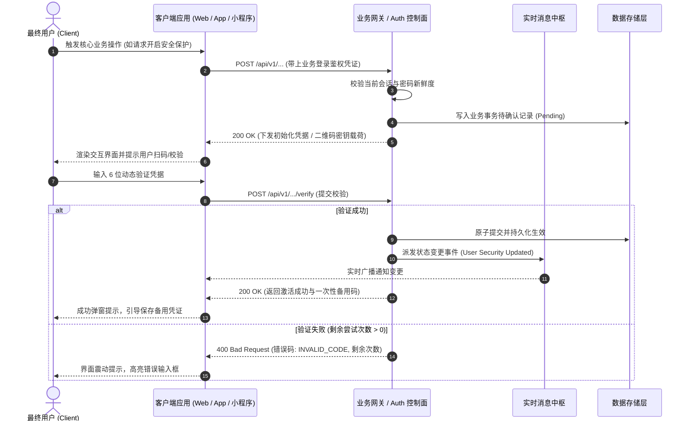
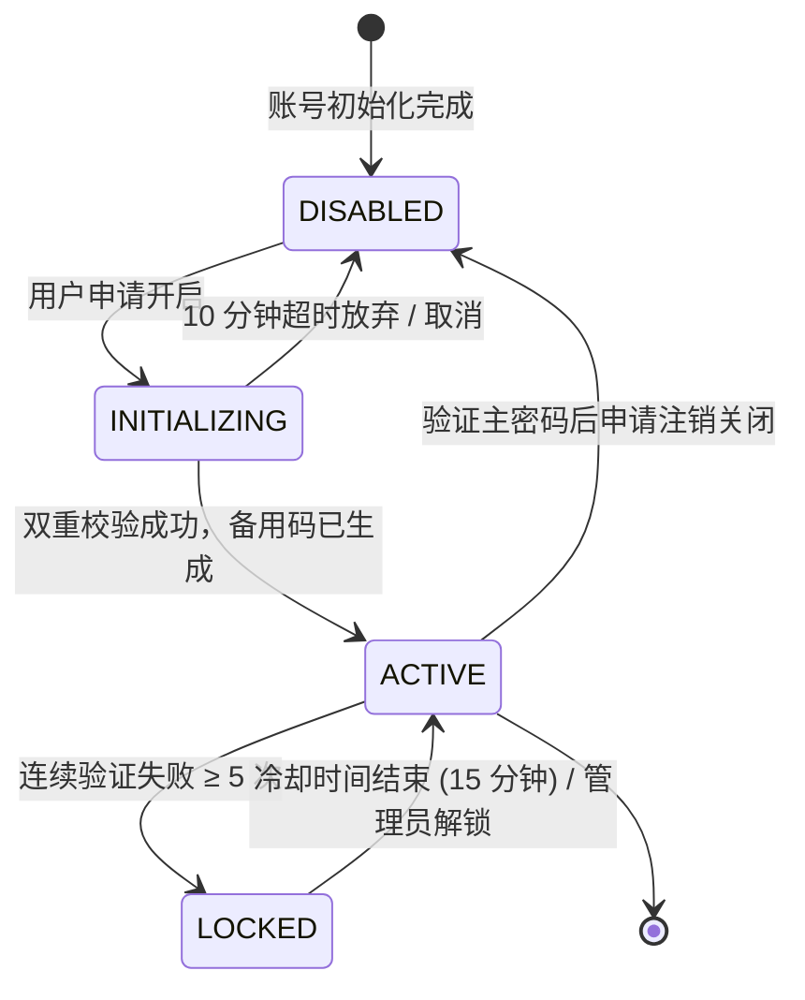

# [特性名称/产品模块] 产品需求规格说明书 (PRD)

> **文档密级**：内部公开 / 核心机密  
> **文档状态**：Draft（草稿）/ In Review（评审中）/ Approved（已定稿）/ In Development（研发中）/ Launched（已上线）  
> **当前版本**：v1.0.0  
> **创建日期**：YYYY-MM-DD  
> **更新日期**：YYYY-MM-DD  

---

## 0. 核心协同团队与版本履历 (Metadata & Revision)

### 0.1 核心干系人表

| 角色 | 负责人 | 所在团队 / 部门 | 联系方式 / IM | 职责说明 |
| :--- | :--- | :--- | :--- | :--- |
| **产品负责人 (PM)** | 张三 | 核心业务产品部 | `zhangsan@example.com` | 需求统筹、业务价值闭环、验收确认 |
| **技术负责人 (Tech Lead)** | 李四 | 后端基础架构部 | `lisi@example.com` | 系统技术方案设计、技术边界评估 |
| **前端负责人 (Frontend)** | 王五 | 用户体验工程部 | `wangwu@example.com` | 客户端 / Web 界面与交互实现 |
| **交互/UI 设计师 (UX/UI)** | 赵六 | 体验设计中心 | `zhaoliu@example.com` | 原型图、高保真视觉与交互动效设计 |
| **质量保证 (QA Lead)** | 孙七 | 质量工程部 | `sunqi@example.com` | 测试用例编写、集成测试与质量门禁 |

### 0.2 版本修订记录

| 版本号 | 修订日期 | 修订人 | 变更类型 | 变更核心摘要与原因 | 评审状态 |
| :--- | :--- | :--- | :--- | :--- | :--- |
| **v1.0.0** | YYYY-MM-DD | 张三 | Create | 初始版本创建，完成核心功能草案定义 | 待评审 |
| **v1.1.0** | YYYY-MM-DD | 张三 | Update | 根据架构评审意见补充安全降级机制与离线草稿箱规格 | 已定稿 |

---

## 1. 需求背景与业务价值 (Context & Business Objectives)

### 1.1 问题陈述 (Problem Statement)

清晰描述目标用户当前面临的具体痛点、操作摩擦或系统瓶颈。回答“为什么现在需要做这个特性？”：
> **现状描述**：用户在...过程中，由于缺少...导致...，进而引发...问题。  
> **数据佐证**：根据最近一季度的工单/埋点统计，约有 34% 的用户在...步骤流失，人均操作耗时高达 4.2 分钟。

### 1.2 商业价值与战略目标 (Business Value)

- **用户价值**：降低操作心智负担，将核心流转路径缩短 50%，提升操作确定性。
- **业务价值**：提升关键转化率、降低客服工单量、补齐企业级安全合规准入能力。
- **战略对齐**：契合本年度“核心系统稳定性与安全体验升级”关键战役。

### 1.3 核心成功衡量指标 (Success Metrics / KPIs)

制定明确的、可量化跟踪的北极星指标与次级业务指标：

| 指标维度 | 当前基线 (Baseline) | 目标值 (Target) | 衡量口径与数据来源 |
| :--- | :--- | :--- | :--- |
| **核心转化率** | 12.5% | ≥ 20.0% | `完成步骤用户数 / 进入步骤总UV`（数仓事件） |
| **平均完成耗时** | 180 秒 | ≤ 45 秒 | `步骤开始时间戳` 至 `提交完成时间戳` 差值 |
| **异常报错率** | 3.2% | ≤ 0.5% | 接口 4xx/5xx 请求数占比 |
| **用户净推荐值 (NPS)** | 24 | ≥ 45 | 流程结束弹窗微调研采样统计 |

### 1.4 本期明确不做的事项目 (Out of Scope / Non-Goals)

清晰划定边界，防止需求蔓延 (Scope Creep)：

- ❌ **不做**：第三方无感凭据自动同步（纳入 Phase 2 评估）；
- ❌ **不做**：面向老旧 IE11 / Android 5.0 以下边缘设备的降级垫片支持。

---

## 2. 用户角色画像与核心旅程 (Personas & User Stories)

### 2.1 目标用户画像

```text
┌─────────────────────────────────────────────────────────────┐
│ 角色代号：企业普通员工 (Alex)                                │
│ ─────────────────────────────────────────────────────────── │
│ • 特征属性：25~35 岁，日常使用 Web 与移动端混合办公          │
│ • 核心诉求：操作极简，验证过程无需频繁输入长密码，快速通行  │
│ • 最大痛点：动态码丢失后找回流程漫长，阻断日常业务办理      │
└─────────────────────────────────────────────────────────────┘
```

### 2.2 用户故事集 (User Stories)

| 编号 | 作为 (As a) | 我希望能够 (I want to) | 以便能够 (So that) | 优先级 |
| :--- | :--- | :--- | :--- | :--- |
| **US-01** | 系统登录用户 | 在个人安全中心一键开启双因素认证 (2FA) | 增强账户资产防御能力，杜绝被撞库风险 | **P0** |
| **US-02** | 已开启 2FA 用户 | 获取并妥善导出一次性应急备用码 (Backup Codes) | 在手机丢失或无法使用 Authenticator 时快速恢复访问 | **P0** |
| **US-03** | 敏感操作用户 | 动态口令验证错误达到 5 次时触发锁定延时保护 | 避免针对个人动态令牌的暴力破解攻击 | **P1** |

---

## 3. 业务全景时序与状态机 (Business Flow & State Machine)

### 3.1 跨端业务交互全景时序 (Sequence Diagram)



### 3.2 实体状态生命周期状态机 (Lifecycle State Machine)



---

## 4. 详细功能规格与字段级交互规则 (Functional Specs & Field Rules)

### 4.1 界面布局与原型映射 (Wireframe & Layout)

在此清晰关联原型文件：`docs/product/prototypes/[feature-id].html`，并说明页面核心信息架构：

```text
┌─────────────────────────────────────────────────────────────┐
│  顶部面包屑：用户中心 / 账户安全 / [当前模块]                 │
├─────────────────────────────────────────────────────────────┤
│  [左侧主面板]                         [右侧侧边指南]         │
│  • 状态卡片：当前激活状态 (Tag)        • 常见安全问题 FAQ     │
│  • 核心操作区：开启 / 配置 / 关闭      • 推荐验证器下载引导   │
│  • 备用凭证区：剩余可用备用码数量 (Badge)                     │
└─────────────────────────────────────────────────────────────┘
```

### 4.2 字段规格与输入校验矩阵 (Field Specification Matrix)

| 字段名称 | 对应键名 (Key) | 数据类型 | 必填 | 客户端输入校验规范 | 服务端兜底约束 | 错误提示文案 (Toast/Inline) |
| :--- | :--- | :--- | :--- | :--- | :--- | :--- |
| **动态验证码** | `code` | `String` | 是 | 必须为纯 6 位数字字符，自动清除前后空格 | 正则 `/^\d{6}$/`，防越界注入 | “请输入标准的 6 位数字动态验证码” |
| **主账户密码** | `password` | `String` | 是 | 长度 8~64 字符，密码框掩码显示 | 恒定时间比对哈希值 | “账户安全密码不正确，请重新输入” |
| **备用恢复码** | `recoveryCode` | `String` | 否 | 格式为 10 位字母数字字符，忽略大小写与横杠 | 转小写去除 `-` 后比对单向哈希 | “输入的备用恢复码无效或已被消耗” |

### 4.3 核心异常分支与交互反馈 (Exception & Interaction Handlers)

1. **网络超时 / 离线异常 (Network Timeout)**：
   - 交互反馈：不刷新页面，按钮呈现重试图标，弹出轻量 Toast：“网络连接受阻，请检查网络后点击重试”；
   - 客户端行为：自动保持已输入的非敏感表单内容，避免用户重复填写。
2. **频控限制 (Rate Limiting - HTTP 429)**：
   - 触发条件：单 IP 或单用户 1 分钟内请求超过 10 次；
   - 交互反馈：禁用提交按钮，并启动 60 秒倒计时器：“操作过于频繁，请在 59 秒后重试”。
3. **空状态与骨架屏 (Skeleton & Empty States)**：
   - 数据加载前：渲染对齐真实布局的灰度脉冲骨架屏（Skeleton Screen），严禁使用全屏突兀 Spinner；
   - 数据为空时：呈现精致插画、明确的状态说明文案以及首要操作引导按钮 (Call to Action)。

---

## 5. 非功能需求与技术边界 (Non-Functional Requirements - NFR)

### 5.1 性能与可用性 SLA

| 维度 | 指标门槛要求 | 监控口径与降级方案 |
| :--- | :--- | :--- |
| **接口响应时延 (Latency)** | P95 ≤ 150ms，P99 ≤ 300ms | 接入全链路 APM 追踪，超时 3000ms 触发熔断 |
| **吞吐预期 (Throughput)** | 稳态 QPS: 50，峰值 QPS: 500 | Redis 令牌桶平滑限流，超限返回 HTTP 429 |
| **可用性 (Availability)** | ≥ 99.95% | 无单点故障，支持多节点横向扩容 |

### 5.2 安全合规与权限策略 (Security & Compliance)

- **准入鉴权**：接口必须强制验证业务 `Authorization: Bearer <token>`；
- **防越权防护 (IDOR)**：必须校验目标资源所属的 `userId` 与当前会话主体的一致性，禁止越权操作他人安全凭证；
- **防重放与暴力破解**：关键提交接口引入时效性防重放机制与指数退避冷却；
- **敏感数据脱敏**：响应中严禁明文返回密钥（仅在初次生成时通过受保护通道回传一次），备用码一律单向哈希落库。

### 5.3 数据埋点与可观测性字典 (Analytics & Telemetry)

| 事件标识 (Event Key) | 触发时机 | 必带业务属性 (Properties) | 埋点上报目的 |
| :--- | :--- | :--- | :--- |
| `security_2fa_view` | 用户进入安全中心页面 | `from_source: string`, `is_enabled: boolean` | 分析安全中心曝光与渗透率 |
| `security_2fa_bind_click` | 用户点击“立即开启” | `user_id: string`, `client_platform: string` | 漏斗转化起始阶段分析 |
| `security_2fa_bind_success` | 验证成功且备用码生成完成 | `duration_ms: number`, `has_copied_backup: boolean` | 核心成功转化率、备用码复制率 |
| `security_2fa_verify_fail` | 输入验证码校验失败 | `error_reason: string`, `attempt_count: number` | 监控异常与疑似攻击行为 |

---

## 6. 迭代排期、依赖与验收标准 (Roadmap & Acceptance Criteria)

### 6.1 阶段里程碑规划

- **Phase 1 (MVP)**：
  - 支持基于 TOTP 的 2FA 绑定与扫码；
  - 支持 8 组一次性备用恢复码生成与导出；
  - 核心登录/校验拦截器接入。
- **Phase 2 (进阶演进)**：
  - 支持基于 FIDO2 / WebAuthn 的 Passkey 无密码生物识别凭证；
  - 信任设备列表管理（30 天内免二次校验）。

### 6.2 交付验收清单 (Definition of Done - DoD)

进入发布流程前，必须逐项勾选确认：

- [ ] **产品功能对齐**：产品经理完成所有核心链路体验测试，与设计稿偏差 ≤ 5%；
- [ ] **多端兼容测试**：已完成 Web 主流浏览器（Chrome、Safari、Firefox、Edge）与移动端适配验证；
- [ ] **自动化测试覆盖**：后端单元测试与领域服务测试覆盖率 ≥ 80%，关键路径具备集成测试用例；
- [ ] **安全基线审查**：通过静态代码安全分析 (SAST)，无越权、SQL 注入或敏感数据泄漏隐患；
- [ ] **文档就绪**：前后端接口文档已同步更新，客户端接入指南就绪。
