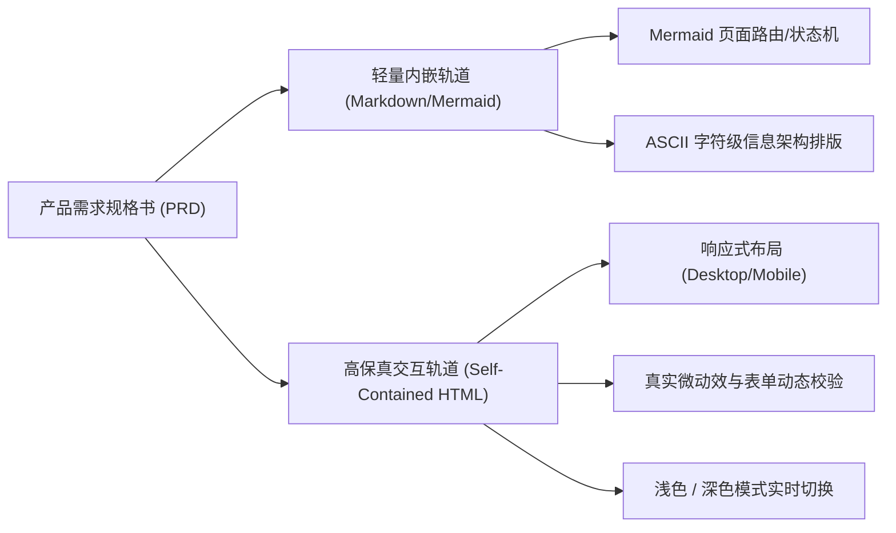
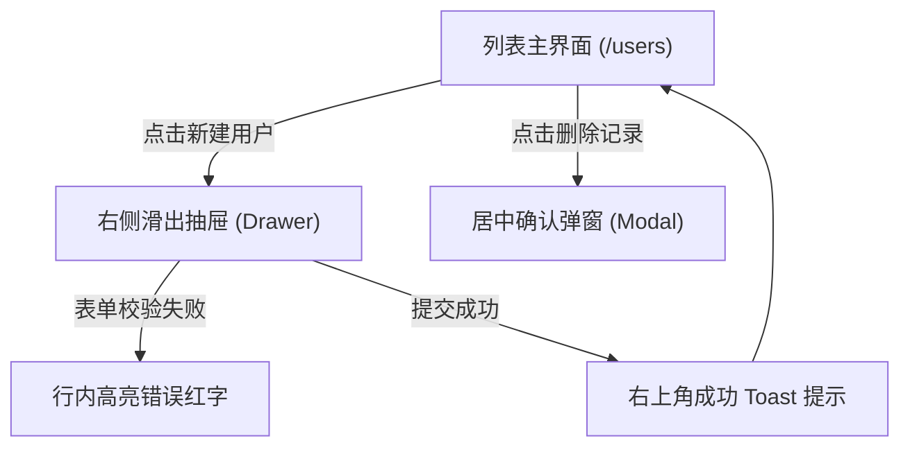

# 工业级产品原型设计与交互标注规范 (Prototype Guidelines)

本规范规定了在代码版本控制系统 (Git) 与敏捷协作流程中，**交互原型图 (Prototypes) 的设计原则、呈现载体、组件语义、标注格式以及交付评审标准**，旨在统一产品经理、交互设计师与前后端工程师的语言契约。

---

## 1. 核心设计原则 (Core Principles)

1. **真实可感，拒绝黑盒 (WYSIWYG & Frictionless)**：
   - 原型必须能让工程师直观理解页面层级、信息密度与状态机变迁，杜绝仅靠文字描述的模糊揣测。
2. **零构建摩擦，自包含优先 (Zero-Build & Self-Contained)**：
   - 纳入仓库的原型资产推荐采用**纯原生 HTML5 / CSS3 / ES6 单文件模式**，无需额外运行 `npm install`、`vite` 等构建流程，任何协同人员“双击即可在浏览器中获得完整高保真交互体验”。
3. **状态完备性 (Exhaustive States)**：
   - 原型必须显式展示组件的 **7 大标准状态**：`默认态 (Default)`、`悬停态 (Hover)`、`激活态 (Active)`、`聚焦态 (Focus)`、`禁用态 (Disabled)`、`加载态 (Loading)` 与 `异常/空状态 (Empty/Error)`。
4. **无障碍设计 (WCAG 2.2 AA Compliance)**：
   - 文本与背景对比度必须满足正常文本 ≥ 4.5:1，大号文本 ≥ 3:1；所有可交互控件提供明确的 `focus-visible` 轮廓指示，支持键盘 Tab 遍历导航。

---

## 2. 原型双轨呈现标准 (Dual-Track Prototype Standard)

在工程实践中，我们推行**“文档内嵌轻量视图 + 独立高保真交互单页”**的双轨制协同标准：



### 2.1 轨道一：Markdown 内嵌轻量视图 (Inline Views)

适用于嵌入 PRD 对应功能章节，便于快速浏览核心信息架构，包含两类标准图示：

#### 规范 1：Mermaid 视图流转与弹窗层级



#### 规范 2：ASCII 字符框线图 (Wireframe Scaffold)

字符框线图用于定义区块层级、间距占比与关键视觉锚点：

```text
+-----------------------------------------------------------------------+
|  [Logo] 系统控制台           [搜索...] (Ctrl+K)       [铃铛: 3] [头像 v] |
+-----------------------------------------------------------------------+
| 导航侧边栏     | 核心工作区：安全中心 > 2FA 双因素认证                 |
| - 基础信息     | +---------------------------------------------------+ |
| - 账号安全 (*) | | [!] 安全风险提示：建议立即开启动态口令保护。       | |
| - 组织权限     | +---------------------------------------------------+ |
| - 操作审计     | | 当前状态：[ 未开启 (灰色) ]        [立即配置 (主按键)] | |
|                | +---------------------------------------------------+ |
|                | | 常见问题：                                        | |
|                | | Q1: 手机丢失如何找回？                            | |
+----------------+-------------------------------------------------------+
```

### 2.2 轨道二：独立高保真交互单页 (Interactive HTML)

文件命名规范：`docs/product/prototypes/<feature-id>-<feature-name>.html`。

- **推荐技术选型（现代化零构建轻量全家桶）**：
  为保持原型极速开发、设计高质、自包含免构建且支持丰富状态机，全局推荐统一采用以下轻量全家桶：
  1. **Tailwind CSS v4 (Browser CDN)**：`<script src="https://cdn.jsdelivr.net/npm/@tailwindcss/browser@4"></script>`，原子化样式与现代色彩断点；
  2. **tw-animate-css**：`<link rel="stylesheet" href="https://cdn.jsdelivr.net/npm/tw-animate-css/dist/tw-animate.min.css">`，纯 CSS-first 入场、出场、缩放动画扩展；
  3. **Lucide Icons**：`<script src="https://cdn.jsdelivr.net/npm/lucide@latest/dist/umd/lucide.min.js"></script>`，现代化矢量图标库；
  4. **Alpine.js v3**：`<script defer src="https://cdn.jsdelivr.net/npm/alpinejs@3.x.x/dist/cdn.min.js"></script>`，声明式双向数据绑定与微状态机驱动。

- **核心工程规范**：
  - 单文件结构，双击浏览器即开，无需任何 node_modules 或 local dev server；
  - 图片优先采用内联 SVG 矢量图标或 CSS 几何绘制，杜绝外部不可靠的图床失效风险；
  - 默认提供沙盒环境状态切换（如通过 `<select>` 快速模拟正常态、空数据、加载中、异常锁定等状态）；
  - 原生提供深色 (Dark Mode) / 浅色 (Light Mode) 实时自适应切换；
  - 内置响应式视口断点（Desktop: ≥ 1024px，Tablet: 768px~1023px，Mobile: < 768px）。

---

## 3. 设计令牌与排版规范 (Design Tokens & Typography)

### 3.1 核心颜色系统 (Color Tokens)

```css
:root {
  /* 品牌核心主色 */
  --primary: #2563eb;           /* Blue 600 - 核心按钮与强调色 */
  --primary-hover: #1d4ed8;     /* Blue 700 - 悬停 */
  --primary-light: #eff6ff;     /* Blue 50 - 浅色底色高亮 */

  /* 语义反馈色 */
  --success: #10b981;           /* Green 500 - 成功 */
  --warning: #f59e0b;           /* Amber 500 - 预警 */
  --danger: #ef4444;            /* Red 500 - 危险/报错 */
  --danger-light: #fef2f2;      /* Red 50 - 错误背景 */

  /* 中性与文本色 (Light Mode) */
  --bg-page: #f8fafc;           /* Slate 50 - 页面大底 */
  --bg-surface: #ffffff;        /* Surface - 卡片/面板底色 */
  --border: #e2e8f0;            /* Slate 200 - 常用边框 */
  --text-main: #0f172a;         /* Slate 900 - 正文大标题 */
  --text-muted: #64748b;        /* Slate 500 - 次要辅助说明 */

  /* 投影与圆角规范 */
  --radius-sm: 4px;
  --radius-md: 8px;
  --radius-lg: 12px;
  --shadow-sm: 0 1px 2px 0 rgb(0 0 0 / 0.05);
  --shadow-md: 0 4px 6px -1px rgb(0 0 0 / 0.1), 0 2px 4px -2px rgb(0 0 0 / 0.1);
  --shadow-lg: 0 10px 15px -3px rgb(0 0 0 / 0.1), 0 4px 6px -4px rgb(0 0 0 / 0.1);
}

/* 深色模式映射 (Dark Mode) */
[data-theme="dark"] {
  --bg-page: #0f172a;
  --bg-surface: #1e293b;
  --border: #334155;
  --text-main: #f8fafc;
  --text-muted: #94a3b8;
  --primary-light: rgba(37, 99, 235, 0.15);
}
```

### 3.2 8px 网格与间距系统 (Spacing Scale)

页面布局、内边距（Padding）与外边距（Margin）一律遵循 8px 基线网格（微调使用 4px）：

- `4px`：极微间距（图标与相邻文字、Tag 内边距）；
- `8px`：紧凑间距（表单项行高、按钮内边距）；
- `16px`：标准间距（卡片内边距、控件间垂直距离）；
- `24px`：大间距（模块卡片间隔、弹窗 Header/Body 间隙）；
- `32px` / `48px`：页面主区域分隔。

---

## 4. 交互微动效与响应时序规范 (Motion & Micro-interactions)

交互动效的目的是提供**确定性的物理反馈**，严禁引入冗长拖沓的装饰性动画：

| 动效类型 | 推荐时长 (Duration) | 缓动曲线 (Easing) | 适用场景 |
| :--- | :--- | :--- | :--- |
| **微反馈 (Micro Feedback)** | 120ms ~ 150ms | `cubic-bezier(0.4, 0, 0.2, 1)` | 按钮点击下沉、Checkbox 勾选、悬停变色 |
| **浮层展开 (Overlay/Modal)** | 200ms ~ 250ms | `cubic-bezier(0, 0, 0.2, 1)` (Decelerate) | 弹窗淡入缩放、抽屉侧边滑出 |
| **浮层收起 (Dismiss)** | 150ms ~ 200ms | `cubic-bezier(0.4, 0, 1, 1)` (Accelerate) | 弹窗关闭、Toast 自动淡出 |
| **列表重排 (List Reorder)** | 250ms ~ 300ms | `cubic-bezier(0.25, 1, 0.5, 1)` | 数据项增删、表格折叠行展开 |

---

## 5. 原型交付与质量验收自检表 (Checklist)

产品经理或设计人员在提交原型前，需逐项完成自检：

- [ ] **语义标签正确**：主标题用 `<h1>`，按钮用 `<button>`，严禁全篇滥用 `<div>` 充当可交互按键；
- [ ] **高亮可交互区域**：原型所有可点击按键有清晰的 `cursor: pointer` 与 Hover 反馈；
- [ ] **键盘与无障碍**：能够使用 `Tab` 键聚焦输入框，按 `Enter` 触发主按键，按 `Esc` 关闭 Modal 弹窗；
- [ ] **空数据状态演示**：必须提供一个切换按键或视角，用于演练列表为空时的视觉形态；
- [ ] **极值与溢出截断**：长字符串、多行文本在表格或卡片中有合理的 `text-overflow: ellipsis` 截断处理；
- [ ] **移动端自适应**：在宽度缩小至 `375px` 时，页面不出现横向滚动条，主要操作按钮占满底部。
