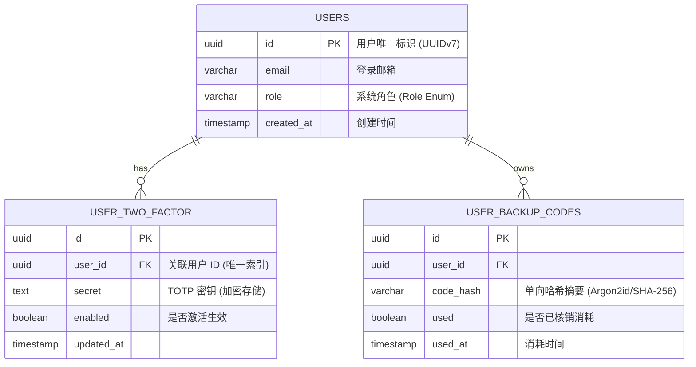
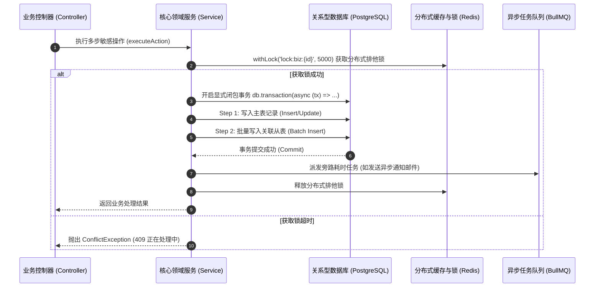

# [特性/子系统名称] 技术架构与系统详细设计规格书 (TRD)

> **关联 PRD**：[PRD 文档相对路径/链接](../product/specs/xxx.md)  
> **文档密级**：内部技术方案  
> **技术架构师 / Lead**：李四  
> **评审技术专家**：后端架构组、安全团队、DBA  
> **当前状态**：Proposal（方案草案）/ Reviewing（评审中）/ Approved（已通过）/ Implemented（已实施）  
> **制定日期**：YYYY-MM-DD  

---

## 1. 架构目标与选型权衡 (Architecture & Trade-offs)

### 1.1 系统架构定位

阐明该功能在现有技术架构中的分层归属（属于 client 业务特性、admin 管理面，还是系统基础设施），以及核心职责边界：

- **模块归属**：`src/features/[client|admin]/[feature-name]/`
- **通信中枢集成**：是否需要集成 Centrifugo 实时广播中枢或 BullMQ 异步队列。

### 1.2 关键技术选型与架构权衡对比矩阵 (ADR Summary)

| 决策维度 | 候选方案 A (Selected) | 候选方案 B (Alternative) | 决策理由与权衡考量 (Trade-off) |
| :--- | :--- | :--- | :--- |
| **持久化策略** | Drizzle ORM + 原生 PostgreSQL 事务 | 存储过程 / 外部多库散装事务 | 遵循代码库扁平数据访问原则，类型安全，事务闭包原子可控 |
| **异步解耦** | Redis + BullMQ 独立消费者 | 进程内 EventEmitter 事件 | 保障峰值流量下任务不丢、支持失败指数退避重试与削峰填谷 |
| **长连接分发** | Centrifugo 专用无状态网关 | NestJS 原生 WebSocket 网关 | 保持业务后端无状态，解耦海量长连接维持，支持多 Pod 平滑伸缩 |

---

## 2. 领域模型与数据持久化设计 (Data Modeling & Storage)

### 2.1 实体关系图 (ER Diagram)



### 2.2 Drizzle ORM Schema 定义规范

贴出拟新增或变更的 Drizzle Schema 代码骨架（存放于 `src/database/drizzle/schema/`）：

```typescript
// 示例：src/database/drizzle/schema/example.schema.ts
import { boolean, pgTable, text, timestamp, uuid, varchar } from 'drizzle-orm/pg-core';
import { user } from './better-auth.schema.js';

export const exampleTable = pgTable('example_entity', {
  id: uuid('id').primaryKey().defaultRandom(),
  userId: uuid('user_id')
    .notNull()
    .references(() => user.id, { onDelete: 'cascade' }),
  status: varchar('status', { length: 32 }).notNull().default('PENDING'),
  metadata: text('metadata'),
  createdAt: timestamp('created_at', { withTimezone: true }).defaultNow().notNull(),
  updatedAt: timestamp('updated_at', { withTimezone: true }).defaultNow().notNull(),
});
```

---

## 3. 核心业务流程与事务边界 (Flow & Transaction Boundaries)

### 3.1 跨服务时序流与多写原子事务 (Transaction Sequence)



---

## 4. 接口契约与请求校验 (API Contracts & DTOs)

### 4.1 RESTful 路由声明矩阵

| HTTP 动词 | 路由路径 (Path) | 访问控制 (Guard) | 功能摘要 (Summary) | 幂等性要求 |
| :--- | :--- | :--- | :--- | :--- |
| `POST` | `/v1/feature/action` | `@Roles(Role.USER)` | 提交业务操作申请 | 需基于 `x-idempotency-key` 幂等 |
| `GET` | `/v1/feature/:id` | `@Roles(Role.USER)` | 查询指定资源详情 (强制 IDOR 校验) | 幂等 (天然只读) |
| `DELETE` | `/v1/feature/:id` | `@Roles(Role.ADMIN)` | 管理员删除/解绑资源 | 幂等 |

### 4.2 Zod 校验 Schema 与 DTO 定义

```typescript
import { z } from 'zod';

export const ExampleActionSchema = z.object({
  targetId: z.string().uuid({ message: '目标 ID 必须为合法 UUID 格式' }),
  verifyCode: z.string().regex(/^\d{6}$/, { message: '验证码必须为纯 6 位数字' }),
});

export type ExampleActionDto = z.infer<typeof ExampleActionSchema>;
```

---

## 5. 高可用、安全防护与容灾设计 (Resilience & Security)

1. **防越权防护 (IDOR Prevention)**：
   - 必须通过当前上下文中提取的会话主体 `req.user.id` 进行数据范围过滤，严禁直接依赖前端传入的 `userId` 执行更新或删除；
2. **防重放与并发击穿 (Idempotency & Concurrency)**：
   - 写操作引入 `withLock('lock:feature:' + id, 3000)` 防止并发重放；
   - 外部调用第三方支付/短信服务必须包裹重试熔断与超时拦截机制；
3. **数据敏感度与脱敏标准**：
   - 密钥在数据库中必须采用 AES-GCM-256 加密或仅存单向哈希，日志严禁打印任何明文 Token / 密钥。

---

## 6. 上线发布与灾备回滚方案 (Rollout & Rollback SOP)

### 6.1 生产发布检查清单 (Release Checklist)

1. **数据库迁移前置执行**：运行 `just db-deploy` 应用向前兼容的 DDL 变更（优先增列，严禁同一发布周期删除已有列）；
2. **环境变量校验**：确认生产环境变量已配置并通过 `env.validation.ts` 启动校验；
3. **金丝雀/灰度放量**：先部署 10% 实例，观察 15 分钟 APM 错误率与 P99 时延，确认无异常后再全量发布。

### 6.2 紧急回滚操作预案 (Emergency Rollback)

- **触发条件**：新版本错误率突增 ≥ 1%，或核心业务流中断超过 3 分钟；
- **回滚步骤**：
  1. 容器集群镜像立即回滚至上一稳定版本 Tag；
  2. 数据库变更因满足向前兼容（Expand/Contract 模式），无需破坏性回退 DDL；
  3. 清除 Redis 中受污染的特定缓存 Key，恢复正常流量。
