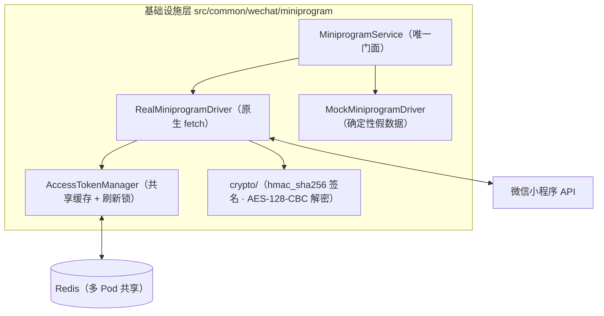

# 微信小程序服务端 API 接入指南

> 本文档说明微信小程序服务端常用接口（凭证 / 登录 / 手机号 / 小程序码 / 内容安全 / 订阅消息）的能力边界、凭证与 access_token 管理、驱动模式、调用方式与错误映射。

---

## 1. 架构总览

小程序能力全部收敛在**基础设施层**，不承载任何业务语义：



- **令牌面**：所有接口失败一律抛 `MiniprogramException`，交由全局 `HttpExceptionFilter` 输出统一错误信封；调用方据 `category` / 错误码分支，**无需硬编码字符串匹配**。
- **零新增依赖**：登录态签名（HMAC-SHA256）、旧版开放数据解密（AES-128-CBC）与 HTTP 客户端分别基于 `node:crypto` 与原生 `fetch`。
- **不落业务数据**：openid 与用户账号的绑定、`session_key` 持久化、手机号落库、二维码存储均属业务侧职责（如 `src/features/client/auth`）。

> **`session_key` 是敏感材料**：它既是旧版开放数据的解密密钥，也是登录态签名的密钥。调用方**必须**在服务端持久化，严禁下发前端或写入日志。

### 微信域目录

`src/common/wechat/` 收敛全部微信生态服务端能力，按「微信子能力」并排分层：

| 目录 | 内容 | 文档 |
| :--- | :--- | :--- |
| `wechat/pay/` | 微信支付 v3（直连商户）：下单 / 退款 / 账单 / 回调验签解密 | [`docs/payment.md`](./payment.md) |
| `wechat/miniprogram/` | 小程序服务端 API：凭证 / 登录 / 手机号 / 小程序码 / 内容安全 / 订阅消息 | 本文档 |

公众号与开放平台能力后续可按同一分层并排落地。

---

## 2. 环境变量与驱动模式

### 2.1 驱动推导

`MINIPROGRAM_DRIVER` 留空时按凭证齐全度自动推导（对齐 `SEARCH_DRIVER` / `WEPAY_DRIVER` 的范式）：

| 条件 | 推导结果 |
| :--- | :--- |
| `MINIPROGRAM_APPID` 与 `MINIPROGRAM_APPSECRET` 齐备 | `real` |
| 其余情况 | `mock` |

> **生产保护**：`APP_ENV=production` 且推导结果为 `mock` 时，应用**直接阻断启动**。小程序接口一旦静默降级为 mock，线上会拿到假 openid、假手机号与假小程序码，属于难以察觉的数据污染，故按 fail-fast 处理。

### 2.2 变量清单

| 变量 | 默认值 | 说明 |
| :--- | :--- | :--- |
| `MINIPROGRAM_DRIVER` | 自动推导 | `real` 或 `mock` |
| `MINIPROGRAM_APPID` | — | 小程序 AppID |
| `MINIPROGRAM_APPSECRET` | — | 小程序 AppSecret（**服务端专用，严禁下发前端**） |
| `MINIPROGRAM_API_BASE` | `https://api.weixin.qq.com` | API 基址 |
| `MINIPROGRAM_TIMEOUT_MS` | `10000` | 请求超时；同步轻请求，短于支付接口 |
| `MINIPROGRAM_ACCESS_TOKEN_SAFETY_WINDOW_SECONDS` | `300` | 凭证提前续期窗口 |

> **出口 IP 白名单**：若小程序在公众平台配置了 IP 白名单，需将服务器出口 IP 加入，否则报 `40164`。

---

## 3. access_token 管理（关键机制）

官方 `stable_token` 普通模式（不传 `force_refresh`）在有效期内**重复调用返回同一凭证**，且与旧的 `/cgi-bin/token` 完全隔离 —— 因此多 Pod 部署**不存在互相顶掉凭证**的问题。项目在此基础上叠加两层优化：

| 层 | 实现 | 目的 |
| :--- | :--- | :--- |
| 共享缓存 | Redis，键 `wechat:miniprogram:access_token:<appid>` | 避免每个业务请求都产生一次到微信的网络往返 |
| 刷新锁 | `RedisService.withLock`（SET NX PX + Lua 原子释放） | 防止多实例在缓存失效瞬间同时回源（击穿） |

**续期策略**：缓存时长取「真实有效期 − 300 秒」并保底 60 秒。因官方在普通模式下亦提前 5 分钟更新凭证，落入窗口后重新获取即可拿到新凭证，自愈无残留。

**强制刷新**只用于凭证失效后的重试：官方对 `force_refresh` 有「**每天 20 次且间隔 30 秒**」的硬限制，绝不可用于常规续期。

> **降级不阻断**：缓存读失败、写失败、锁不可用（如 Redis 抖动）均只记录 `warn` 并退化为直接回源 —— 凭证获取是业务链路的前置依赖，不能因缓存层故障而整体不可用。

---

## 4. 调用方式

`MiniprogramService` 为全局 `@Global()` 模块导出的唯一门面，业务侧直接注入即可。

### 4.1 登录

```ts
const { openid, sessionKey, unionid } = await this.miniprogram.code2Session(jsCode);

// 校验登录态：失效返回 false 而非抛错（这是查询的正常答案）
const valid = await this.miniprogram.checkSessionKey(openid, sessionKey);

// 重置登录态：旧密钥立即失效，新密钥只能从返回值取得
const reset = await this.miniprogram.resetUserSessionKey(openid, sessionKey);
```

| 接口 | 官方路径 | 鉴权 | 备注 |
| :--- | :--- | :--- | :--- |
| `code2Session` | `GET /sns/jscode2session` | `appid` + `secret` | **不需要 access_token**；`js_code` 一次性、5 分钟有效 |
| `checkSessionKey` | `GET /wxa/checksession` | access_token | 签名 `hmac_sha256(session_key, "")` |
| `resetUserSessionKey` | `GET /wxa/resetusersessionkey` | access_token | 频率 6 万次/分钟；重置不为 session_key 续期 |

`checkSessionKey` / `resetUserSessionKey` 均以 **session_key 作密钥对空字符串做 HMAC-SHA256** 完成校验，服务端无需明文传输 session_key。

### 4.2 手机号

```ts
const info = await this.miniprogram.getPhoneNumber({ code, openid });
// → { phoneNumber, purePhoneNumber, countryCode, watermark }
```

`code` 由前端 `button open-type="getPhoneNumber"` 回调返回，**一次性且 5 分钟有效**。传入 `openid` 会额外校验与 `code` 的绑定关系。

**旧版开放数据解密**（仅服务存量客户端）：

```ts
const data = this.miniprogram.decryptUserData(sessionKey, encryptedData, iv);
```

该方法为纯函数能力、不发起网络请求，且**默认使用当前小程序 appid 校验数据水印**（`expectedAppid` 可覆盖），阻断「用其他小程序的密文冒充本小程序用户数据」的跨应用重放。

### 4.3 小程序码 / 小程序二维码

```ts
const image = await this.miniprogram.createUnlimitedQrCode({
  scene: 'a=1',                 // 最长 32 个可见字符
  page: 'pages/index/index',    // 已发布页面，不加 /、不带参数（参数放 scene）
  envVersion: 'release',
  width: 430,                   // 280 ~ 1280
});
// → { buffer: Buffer, contentType: 'image/jpeg' }
```

| 接口 | 官方路径 | 数量限制 | 适用 |
| :--- | :--- | :--- | :--- |
| `createUnlimitedQrCode` | `POST /wxa/getwxacodeunlimit` | 无限制 | **业务二维码首选** |
| `createQrCode` | `POST /wxa/getwxacode` | 总量 10 万 | 码数量较少的场景 |
| `createPlainQrCode` | `POST /cgi-bin/wxaapp/createwxaqrcode` | 总量 10 万 | 无圆形码外观 |

**两处必须知晓的约束**：

1. **返回双形态**：成功直接返回**图片二进制**，失败才返回 **JSON**（含 `errcode`）。本模块以**应答首字节**判别（图片魔数不可能以 `{` / `[` 开头），比依赖 `Content-Type` 更可靠 —— 部分网关会改写该头。
2. **scene 字符集受限**：仅支持数字、大小写英文与 `!#$&'()*+,/:;=?@-._~`；**中文与 `%` 均不合法**（`%` 不可用 URL 编码绕过）。建议放短码或索引，业务参数在数据库侧还原。

> 基建层只交还原始字节与 MIME，**不做存储决策** —— 存对象存储、回 base64 还是直接回流，由调用方按业务决定。

### 4.4 内容安全

```ts
const result = await this.miniprogram.checkText({
  content: userInput,
  scene: 2,          // 1 资料 / 2 评论 / 3 论坛 / 4 社交日志
  openid,
});

if (!result.pass) {
  // suggest: 'risky' 建议拦截；'review' 建议转人工
}
```

> **2.0 语义陷阱**：内容安全 **2.0 在检测到违规时仍返回 `errcode = 0`**，是否违规必须依据 `result.suggest` 判定（`errcode = 87014` 是 1.0 的旧语义）。因此**不能以「未抛异常」视为通过**。
>
> 另外，应答中缺少可判定的 `suggest` 时本模块**直接抛错**（fail-closed）—— 内容审核宁可错杀，绝不默认放行。

`label` 枚举：`100` 正常、`10001` 广告、`20001` 时政、`20002` 色情、`20003` 辱骂、`20006` 违法犯罪、`20008` 欺诈、`20012` 低俗、`20013` 版权、`21000` 其他。

场景限制：`openid` 对应用户需在**近两小时内访问过小程序**，否则报 `61010`；接口频率 4000 次/分钟、200 万次/天（**未上架小程序仅 100 次/天**）。

### 4.5 订阅消息

```ts
await this.miniprogram.sendSubscribeMessage({
  touser: openid,
  templateId: 'TPL_ID',
  data: { phrase3: { value: '审核通过' } },
  page: 'pages/order/detail?id=1',
  // miniprogramState 默认 'formal'，lang 默认 'zh_CN'
});
```

`touser` / `templateId` / `data` 均为必填，且 `data` 的键与取值须匹配模板规则，否则报 `47003`。返回值含 `40101` 之外的业务分支：

| 错误码 | 语义 | HTTP |
| :--- | :--- | :--- |
| `43101` | 用户未订阅或一次性订阅次数已用完 | 409 |
| `43107` | 订阅消息能力被封禁 | 403 |
| `43108` | 并发下发消息给同一用户 | 409 |
| `45168` | 下发消息命中敏感词 | 400 |

---

## 5. 错误映射

小程序接口采用「**HTTP 200 + body 内 `errcode`**」的错误模型，与微信支付 v3 的 HTTP 状态码模型**完全不同**。因此：

- `category`（权威）：判定可重试性与业务处置方式；
- `status`（回退）：仅在无 HTTP 应答状态可用时生效（自定义错误码、网络/超时等本地失败）。

### 5.1 错误分类

| 分类 | 含义 | 典型错误码 |
| :--- | :--- | :--- |
| `invalid-request` | 参数或配置不符，重试无意义 | `40003` `40029` `40097` `40129` `47001` |
| `auth` | 凭证、密钥、签名、登录态问题 | `40001` `40013` `40125` `42001` `87009` |
| `permission` | 接口权限、IP 白名单、能力封禁 | `40164` `48001` `43107` `89503` |
| `risk-control` | 内容或用户风控拦截 | `40226` `87014` `45168` |
| `business-state` | 业务状态冲突 | `43101` `43108` `61010` `87007` |
| `not-found` | 目标资源不存在 | `41030` |
| `rate-limited` | 频率限制 | `45009` `45011` `44991` |
| `upstream` | 微信侧异常或网络故障 | `-1`、超时、网络异常 |

### 5.2 容错边界

| 行为 | 适用范围 | 理由 |
| :--- | :--- | :--- |
| **凭证失效自动重试** | 全部接口 | `42001` / `40001` / `40014` / `41001` → 强制刷新 access_token 后重试一次 |
| **原样重试**（2 次） | `stable_token`、`checkSessionKey`、`checkText`、三个小程序码接口 | 幂等安全且无副作用 |
| **不重试** | `code2Session`、`getPhoneNumber`、`resetUserSessionKey`、`sendSubscribeMessage` | 一次性凭证消费或写操作 |

`code2Session` / `getPhoneNumber` 的 `code` **一次性**，重试必然得到 `40029`，反而掩盖原始错误；`resetUserSessionKey` 每次轮换密钥，重试拿到的结果与首次不同；`sendSubscribeMessage` 重试可能导致用户收到重复消息。

### 5.3 模块自定义错误码

以 `MINIPROGRAM_` 前缀命名，覆盖配置、网络、入参约束三类：

| 错误码 | HTTP | 触发场景 |
| :--- | :--- | :--- |
| `MINIPROGRAM_CONFIG_INCOMPLETE` | 500 | 凭证不完整 |
| `MINIPROGRAM_TIMEOUT` / `MINIPROGRAM_NETWORK_ERROR` | 504 / 502 | 超时与网络异常 |
| `MINIPROGRAM_INVALID_RESPONSE` | 502 | 应答缺失必需字段（含内容安全缺少可判定 `suggest`） |
| `MINIPROGRAM_BINARY_ERROR` | 502 | 小程序码接口返回无法解析的应答 |
| `MINIPROGRAM_QR_*` | 400 | scene 缺失/超长/字符非法、path 缺失/带 `/`/带参数/超 128 字节、宽度越界 |
| `MINIPROGRAM_CONTENT_*` | 400 | 文本缺失或超过 2500 字 |
| `MINIPROGRAM_DECRYPT_FAILED` | 500 | 旧版开放数据解密失败或水印 appid 不匹配 |

---

## 6. 本地开发与联调

未配置 `MINIPROGRAM_APPID` / `MINIPROGRAM_APPSECRET` 时自动启用 **mock 驱动**，提供**确定性**假数据但保持与真实驱动完全一致的入参校验与返回结构：

| 能力 | mock 行为 |
| :--- | :--- |
| 凭证 | 由 appid 确定性派生 |
| `code2Session` | 由 `jsCode` 派生 openid / session_key，并登记登录态 |
| `checkSessionKey` | 真实 HMAC 校验；未知用户或不匹配密钥返回 `false` |
| `resetUserSessionKey` | 轮换密钥；无效登录态报 `87007` |
| `getPhoneNumber` | 派生 11 位手机号 + 水印 |
| 小程序码 | 返回结构合法的 1×1 PNG 与 `image/png` |
| `checkText` | 命中 `违规` / `risky` / `badword` → `risky`；命中 `review` / `待审` → `review` |
| `sendSubscribeMessage` | 通过校验后成功 |

### 健康检查

`GET /readyz`（就绪探针）包含 `miniprogram` 指标，**仅做本地校验**（驱动类型与凭证齐全度），**不发起任何外部请求** —— 避免探针按频率消耗凭证配额。未配置凭证时以 `state: 'degraded'` 上报，不触发 503 误杀。

### 单元测试

```bash
bun x vitest run tests/unit/common/wechat
```

覆盖登录态签名真值、AES-128-CBC 解密与水印校验、错误码映射全表、access_token 缓存与并发击穿、真实驱动的错误转译/重试边界/二进制判别、mock 驱动契约与入参校验。

---

## 7. 排障速查

| 现象 | 排查方向 |
| :--- | :--- |
| `40164 invalid ip not in whitelist` | 服务器出口 IP 未加入公众平台白名单 |
| `40001` 反复出现 | AppSecret 错误；或本地缓存了失效凭证（检查 Redis 键 `wechat:miniprogram:access_token:*`） |
| `41030 invalid page` | `page` 加了 `/` 前缀、携带了参数，或该页面未在现网版本中存在 |
| `40129` / `40169 scene 不合法` | `scene` 含中文或 `%`，或超过 32 个可见字符 |
| `61010` | 用户未在近两小时内访问过小程序（内容安全接口要求） |
| `43101` | 用户未订阅或一次性订阅次数已用完 —— 属正常业务分支，非故障 |
| 内容检测「未报错但违规内容放行」 | 2.0 语义下违规不体现在 `errcode`，必须读取 `result.suggest` / `result.pass` |
| 小程序码返回内容无法解析 | 失败时返回的是 JSON，须按首字节判别而非直接当图片处理 |
| 生产启动被阻断 | 凭证缺失导致推导为 `mock`，按提示补齐 `MINIPROGRAM_APPID` / `MINIPROGRAM_APPSECRET` |
